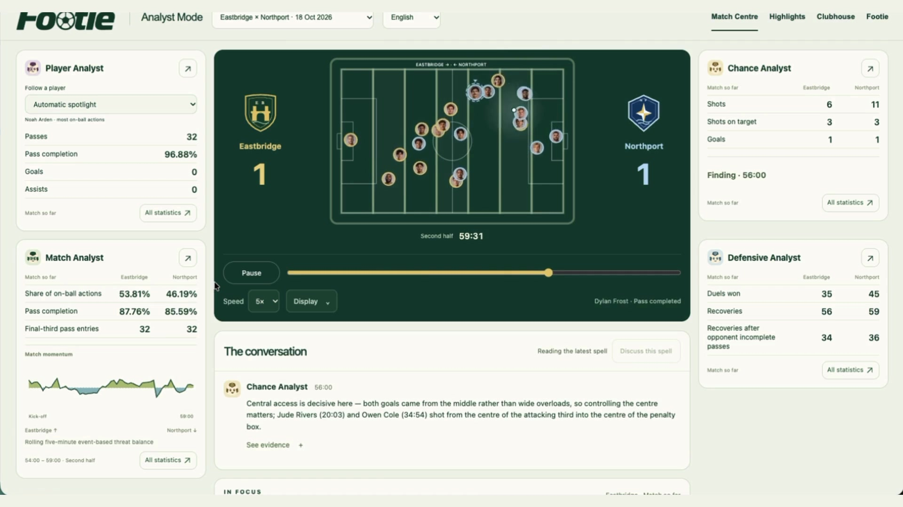
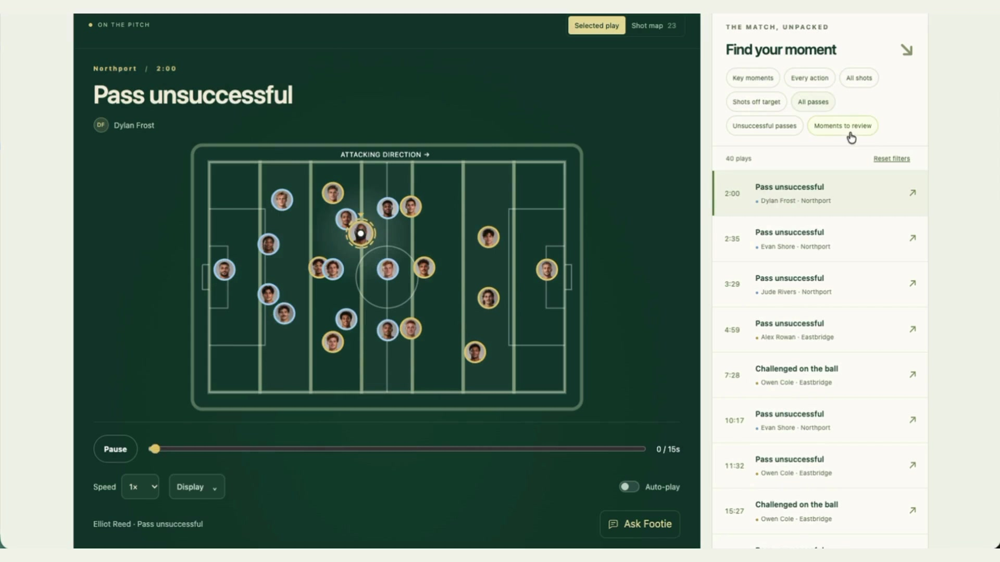
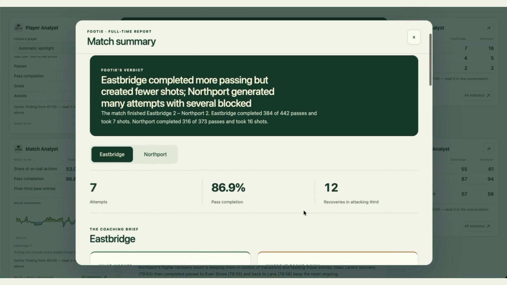
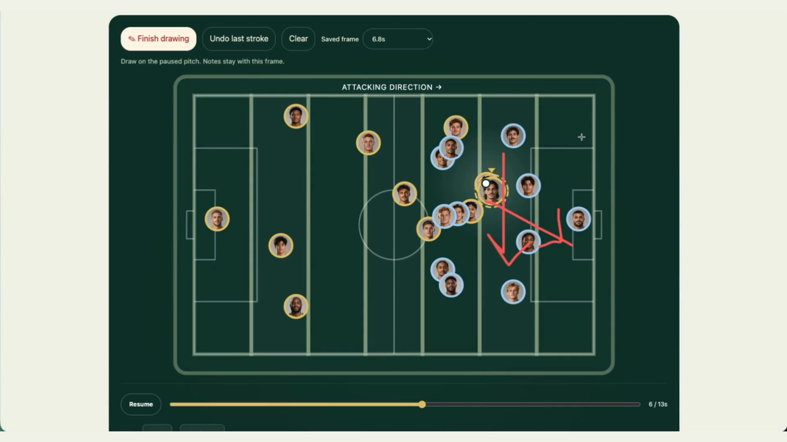
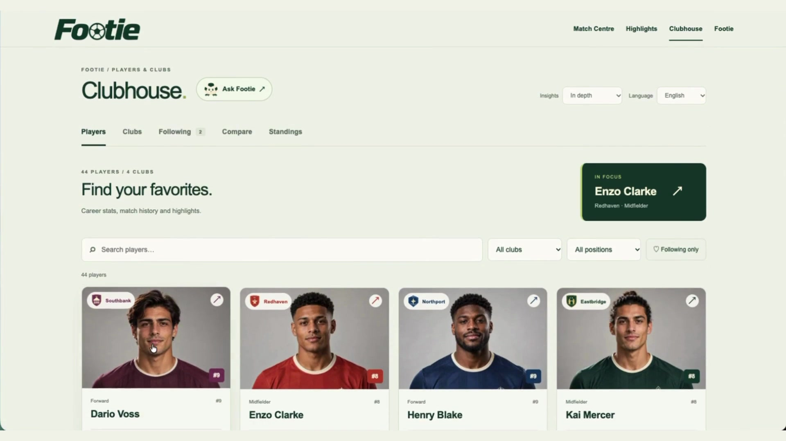
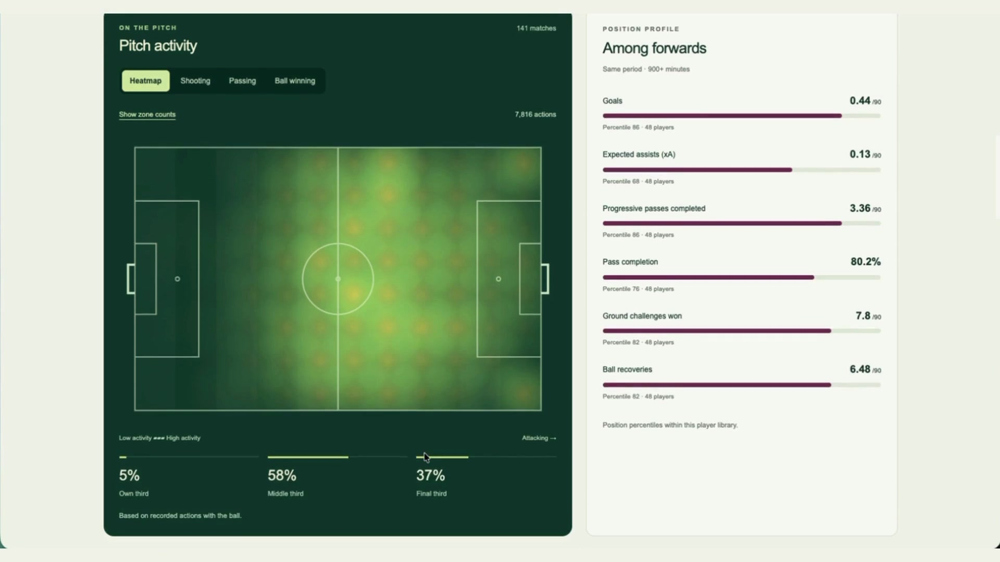
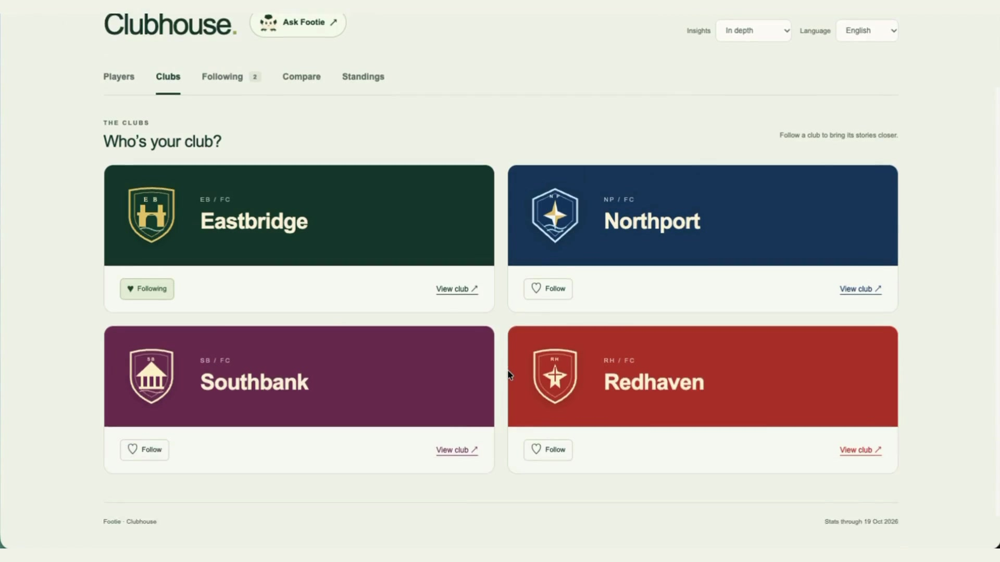
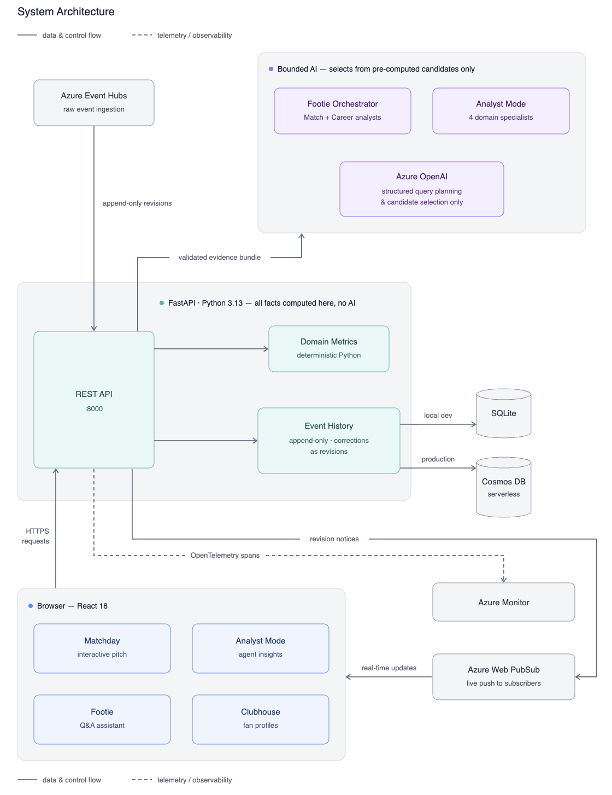

<div align="center">

# Footie (CounterPress)

[](https://github.com/Haydnlee31/CounterPress/actions/workflows/ci.yml)


**Your club. Your moments. Your understanding of the game.**

Football intelligence for fans, analysts and coaches: follow your players, replay the action, hear specialist perspectives and keep the moments that matter.

[Open Footie](https://counterpress.icyplant-0eb80d8e.eastus.azurecontainerapps.io/) · [Watch the demo](https://www.youtube.com/watch?v=vqpPXBcn0R0) · [Quick start](#quick-start) · [Architecture](#architecture)

[](https://www.youtube.com/watch?v=vqpPXBcn0R0)

*Watch the two-minute walkthrough on YouTube, or explore the app without signing in.*

</div>

## Start with the game

Footie connects a match replay, a developing analyst conversation and a personalised football record. The same play can be a fan's favourite goal, a player's contribution to a move, or a coaching point to revisit on the pitch.

The main navigation has four workspaces: **Match Centre**, **Highlights**, **Clubhouse** and **Footie**. **Analyst Mode** opens from Match Centre's full-match view.

### Match Centre — find the moment

Start with the match overview, browse moments using the action filter, or watch the full-match replay. Player portraits, hover cards, shot trajectories and playback controls help you follow the action. Save a moment to Highlights when you want to return to it.



### Analyst Mode — four perspectives, one conversation

Watch the match alongside four specialists:

| Analyst | What they follow |
|---|---|
| **Player Analyst** | Individual involvement, passing, goals and assists, with a selectable player focus and activity map. |
| **Match Analyst** | The broader balance of play, progression, passing patterns and momentum. |
| **Chance Analyst** | Shot creation, shooting outcomes and the passages that lead to opportunities. |
| **Defensive Analyst** | Duels, recoveries and how a team responds when possession changes. |

As the replay advances, a turn manager gives relevant specialists new, linked passages of play. They can build on or qualify a colleague's earlier finding. Footie reviews proposed commentary against the current evidence before publication; quiet spells can pass without a forced comment. The latest contribution stays visible, with earlier discussion and supporting actions available to inspect.

At full time, an automatic **match report** brings together each team's strengths, weaknesses and practical coaching ideas. Pitch-zone and shot visuals help connect the interpretation to the recorded action.



### Highlights — keep it, replay it, draw on it

Save a moment from Match Centre into your own collection. Replay the sequence, read **Footie's Summary**, add coaching notes and draw red-pen annotations on the pitch. Preloaded highlights provide ready-to-explore examples, while Breakdown lets you inspect the build-up more closely.

Collections, drawings and notes are saved in your browser.



### Clubhouse — make it yours

Explore **44 featured players across four clubs**. Follow favourites, compare players, inspect career and season statistics, and browse match histories. Player profiles include event-location heatmaps and role-relevant metrics; club profiles and standings add the team perspective. Your follows shape the recommendations you see.



| Player insight | Club discovery |
|---|---|
|  |  |

### Footie — ask about the records

Ask questions about a player, club or match, compare performances, and inspect the figures behind an answer. The assistant can delegate match and career questions to specialists using validated data tools. Contextual **Ask Footie** controls connect questions to player profiles and replay moments.

English and Simplified Chinese language options are available.

## How the intelligence works

Footie combines computed football metrics with model-authored interpretation. It is not limited to selecting prewritten sentences.

1. **Read the available events.** Stable match/event IDs, revisions and availability times define what is known at the current replay position.
2. **Compute the facts.** Python derives statistics and links recorded actions into passages of play. The model is not responsible for inventing or calculating the underlying totals.
3. **Ask a relevant specialist.** The live manager supplies a role-specific evidence packet and earlier approved discussion, so commentary can connect actions and explain their significance.
4. **Review before publishing.** Independent model review and deterministic checks assess factual support, references, timing and repetition. Unsupported drafts are withheld.
5. **Let the viewer inspect it.** Published findings retain their source time and evidence links. Full-time reports consider the wider match record.

These checks reduce unsupported claims; they do not make model interpretation infallible. Seeking, changing matches or receiving corrections invalidates stale results rather than carrying future or outdated findings into the current view.

## Architecture

<div align="center">

</div>

**Two complementary paths:** Event Hubs and Web PubSub handle incoming revisions; the curated match library drives the replay experience. Accelerated playback reveals recorded events at its replay clock—it is not a live video feed.

The current live analyst conversation uses an application-managed turn scheduler in Azure Container Apps. The general Footie assistant uses Microsoft Agent Framework for specialist coordination. Separate native Foundry agent integrations also exist; the live scheduler should not be confused with that execution path.

| Layer | Implementation |
|---|---|
| Interface | React 19, TypeScript, Vite |
| API and data contracts | FastAPI, Pydantic, Python |
| Local and cloud persistence | SQLite; Azure Cosmos DB for hosted history and shared state |
| AI | Azure OpenAI; Microsoft Agent Framework assistant coordination |
| Streaming | Azure Event Hubs, Blob checkpoints, Azure Web PubSub |
| Hosting and delivery | Azure Container Apps, Container Registry, Bicep, GitHub Actions with Entra OIDC |
| Observability | OpenTelemetry, Azure Monitor and Foundry-linked tracing |
| Verification | pytest, Vitest, model evaluations and replay acceptance checks |

## Data and scope

Featured clubs and players are fictional. The career dataset contains **840 historical fixtures**; player histories include matches beyond the curated replay library. Synthetic statistics are calibrated against licensed football event data, with role-specific validation rather than arbitrary totals.

The pitch is **105 × 68 metres**, with normalized attacking direction for analysis. Comparison windows exclude their start and include their end. Event-location heatmaps show where recorded actions occurred; supporting replay movement is reconstructed, not measured continuous player tracking. Video upload, automatic event extraction and measured sprint tracking are not current features.

Source attribution: Luca Pappalardo and Emanuele Massucco / Wyscout, [events](https://doi.org/10.6084/m9.figshare.7770599), [matches](https://doi.org/10.6084/m9.figshare.7770422) and [players](https://doi.org/10.6084/m9.figshare.7765196), licensed [CC BY 4.0](https://creativecommons.org/licenses/by/4.0/). Adaptations include fictional display identities, coordinate scaling, aggregate calibration and generated fixtures. See the [data methodology](docs/personalization-data.md) and [positional validation](docs/position-calibration.md).

## Quick start

Use Python 3.13, [uv](https://docs.astral.sh/uv/getting-started/installation/) and Node.js 24. Replay and statistics browsing work locally without Azure credentials; model-generated discussion, summaries and answers require configured Azure access.

**Backend** — from the repository root:

```sh
uv sync --locked
uv run --frozen uvicorn counterpress.api.main:app --host 127.0.0.1 --port 8000 --reload
```

**Frontend** — in a second terminal:

```sh
cd frontend
npm ci --no-audit --no-fund
npm run dev
```

Open [localhost:5173](http://127.0.0.1:5173/) for the app or [localhost:8000/docs](http://127.0.0.1:8000/docs) for the API. Check backend health with `curl http://127.0.0.1:8000/health`.

**Local AI preview** — after configuring server-side Azure model access, build the frontend, then start the desired preview from the repository root:

```sh
npm --prefix frontend run build

# Footie assistant with Match and Career specialists
uv run --frozen python scripts/run_footie_local.py --azure --multiagent --port 8021

# Alternatively: Analyst Mode with live discussion
uv run --frozen python scripts/run_analyst_local.py --discussion --port 8018
```

Open `http://127.0.0.1:8021/#assistant` or `http://127.0.0.1:8018/#analyst`, respectively. Keep credentials in local, ignored configuration or managed identity bindings—never in the frontend or repository.

**Tests:**

```sh
uv run --frozen pytest -q
npm --prefix frontend test
npm --prefix frontend run build
```

Repository URLs, Python package names and configuration identifiers retain their existing technical names so links, commands and integrations continue to work.

## Workspace links

| Route | Experience |
|---|---|
| `/` or `#gi` | Match Centre: overview, moments and full-match replay |
| `#analyst` | Specialist conversation, player focus and full-time report |
| `#highlights` | Saved moments, summaries, annotations and coaching notes |
| `#highlights/preloaded` | Preloaded highlight replays |
| `#matchday/breakdown` | Detailed breakdown of a preloaded highlight |
| `#football` | Clubhouse: players, clubs, following, comparisons and standings |
| `#assistant` | Footie questions and evidence-backed answers |

## Documentation

| Guide | What it covers |
|---|---|
| [Analyst conversation and reports](docs/analyst-room.md) | Live scheduling, evidence, memory, reports and release history |
| [Highlights workspace](docs/highlights-workspace.md) | Saved replays, summaries and annotations |
| [Footie assistant](docs/grounded-assistant.md) | Data tools and specialist coordination |
| [Player and club data](docs/personalization-data.md) | Generation, calibration, coverage and API contracts |
| [Fan personalization](docs/fan-personalization.md) | Profiles, follows and personalised recommendations |
| [Streaming](docs/streaming.md) | Event Hubs ingestion and Web PubSub revision delivery |
| [Deployment](docs/deployment.md) | Azure operations and release verification |

Screenshots above are stills from the latest Footie demo recording, captured on 28 October 2026. The [demo video](https://www.youtube.com/watch?v=vqpPXBcn0R0) shows the complete walkthrough.
