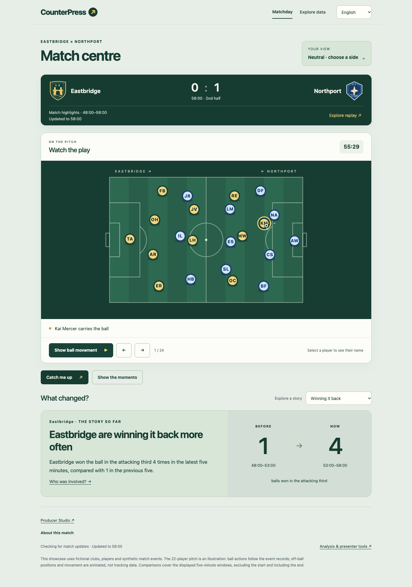
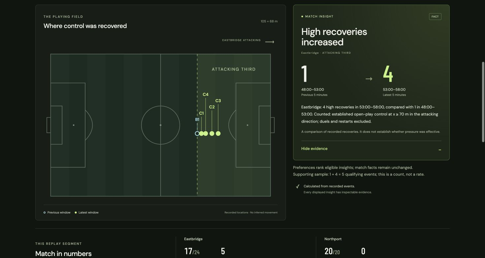
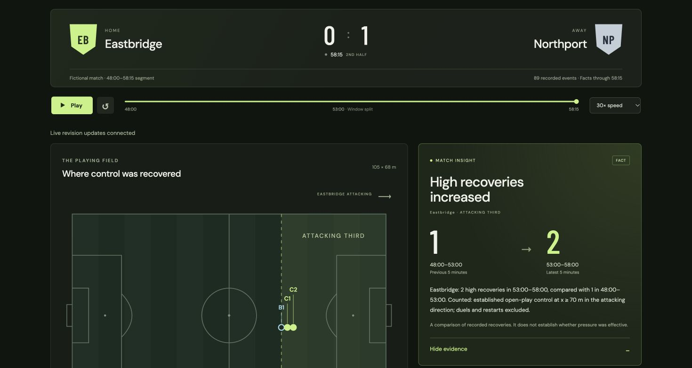

<div align="center">

# CounterPress

[](https://github.com/Haydnlee31/CounterPress/actions/workflows/ci.yml)


<br>

***Synthetic football intelligence -- deterministic match replays with evidence-backed analytical insights.***

<br>

[Live Demo](https://counterpress.icyplant-0eb80d8e.eastus.azurecontainerapps.io/) | [Documentation](#documentation) | [Quick Start](#quick-start) | [Architecture](#architecture)

<br>



</div>

---

## What is CounterPress?

**CounterPress turns raw football events into an interactive, inspectable replay experience where every single claim traces back to exact event records, timestamps, field coordinates, and revision IDs.** There are no hallucinated narratives, no ungrounded AI prose, and no hidden assumptions. The platform covers the full lifecycle of football intelligence -- from event ingestion and deterministic metric computation, through multi-workspace visual analysis, all the way to deep-linked evidence inspection.

Coaches see actionable pattern breakdowns. Analysts see verifiable evidence chains. Fans see clear, cited stories. Editorial teams see presenter-ready overlays. Everyone sees the same ground truth.

The platform ships with 44 featured players, 4 clubs, 840 historical fixtures, and 4 full featured matches -- all queryable, all traceable, all deterministic.

> "If you cannot point to the exact event record that supports a claim, the claim does not appear on screen."
>
> -- The CounterPress design principle

---

## Live Demo

<div align="center">

<br>

**No sign-in. No API key. No Azure account. Just open the link.**

### [counterpress.icyplant-0eb80d8e.eastus.azurecontainerapps.io](https://counterpress.icyplant-0eb80d8e.eastus.azurecontainerapps.io/)

<br>



<br><br>

</div>

---

## Philosophy -- Bounded AI

> CounterPress treats AI as a selector, not a generator. Azure OpenAI chooses from pre-computed candidates and plans structured queries. It never fabricates facts. Every model call is bounded by design: $0.10 per run, $30 lifetime cap, 120 runs per hour -- enforced in durable shared admission, not just client-side limits.

The system works through a strict separation of concerns:

```
Raw Events --> Deterministic Metrics --> Pre-computed Candidates --> AI Selection --> Cited Display
     |                |                         |                        |              |
  Append-only    Python-computed         Evidence-linked         Structured only    Traceable
  with revisions   no model calls       never model-generated   query planning     to source
```

Corrections append new revisions rather than overwriting. Any historical state can be reconstructed. The synthetic generator is seeded and deterministic -- Brier scores of 0.114 (pass completion) and 0.095 (shot conversion) calibrated on 2017/18 English league data (CC BY 4.0).

---

## Features

### Matchday -- The Interactive Pitch

The default workspace. A full 22-player animated pitch with ball movement, play/pause controls, and configurable speed (0.5x, 1x, 1.5x). Click any player marker to inspect their name, position, and current involvement. The "Catch me up" button generates cited segment stories from the active time window. Team preferences, language selection, and explanation depth are saved on-device with no sign-in required. On mobile, the pitch renders in portrait orientation with reduced-motion fallback for accessibility.

### Analyst Mode -- Four Specialist Agents

Four domain-specific analysts -- Chances, Build-up, Transitions, and Player Impact -- each select insights from pre-generated evidence candidates. This is not free-form generation: the agents operate within a bounded execution framework with native Foundry execution paths. Statistics are sampled every 15 seconds during playback, with full analysis requests at 1-minute intervals. The spending cap of $0.10 per run is enforced server-side.

### Footie -- The Grounded Multi-Agent Assistant

A conversational Q&A system where the Footie Orchestrator delegates to a Match Analyst and a Career Analyst. Each specialist executes validated Python queries against a consistent football-record snapshot. Answers are pre-calculated facts, not model-generated prose. At most two model calls per question. Contextual dialogs surface on player profiles, replays, and highlights -- always grounded in the same deterministic data layer.

### Highlight Breakdown and Exploration

Three authored highlight replays with build-up phase inspection, player involvement tracking, phase-by-phase comparisons, and timeline breakdowns. Every phase links back to the events that composed it. Bilingual support in English and Simplified Chinese.

### Real-Time Streaming

Azure Event Hubs ingestion with Blob Storage checkpoints feeds revision notices through Azure Web PubSub to browser subscribers in real time. Duplicate delivery is prevented at the protocol level, with browser-side reconciliation on reconnect ensuring no missed updates and no phantom duplicates.

<div align="center">

</div>

### Studio -- Editorial Tools

Opt-in editorial review and presenter tooling behind Entra/OIDC authentication. Presenter cues, lower-third previews, and verified HTML downloads -- all backed by the same evidence layer, with Cosmos DB and SQLite quotas enforced per session.

### Clubhouse -- Fan Personalization

Device-only personalization with zero sign-in friction. Favorite clubs (4 available), favorite players (12 featured per club), primary club and focus player selection. Player and club profiles with career totals, season statistics, activity maps, and evidence links. A ranked highlights home feed adapts to fan preferences, and 2-to-4 player comparisons render side-by-side with shared axes.

---

## Frontend Workspaces

| Route | Purpose |
|---------------|-----------------------------------------------------|
| `#matchday`   | Interactive 22-player pitch, highlights, catch-me-up |
| `#analyst`    | Full-match reading with 4 specialist agent insights   |
| `#explore`    | Highlight breakdown with build-up phases              |
| `#gi`         | Full-match event reader, shot map, pitch canvas       |
| `#assistant`  | Footie multi-agent Q&A                                |
| `#studio`     | Editorial review and presenter tools                  |
| `#football`   | Clubhouse -- device-only fan personalization           |

---

## Architecture

<div align="center">

</div>

---

## Tech Stack

| Layer                  | Technology                                              |
|------------------------|---------------------------------------------------------|
| Frontend               | React 18, TypeScript, Vite                              |
| Backend                | FastAPI 0.115+, Pydantic 2.10+, Python 3.13            |
| Local storage          | SQLite                                                  |
| Cloud storage          | Azure Cosmos DB (serverless)                            |
| AI orchestration       | Microsoft Agent Framework Core 1.23+, Azure OpenAI     |
| Streaming              | Azure Event Hubs, Azure Web PubSub                     |
| Containerisation       | Docker (digest-pinned, read-only FS)                    |
| Infrastructure         | Azure Container Apps, Bicep                             |
| CI/CD                  | GitHub Actions (Entra OIDC), uv 0.11.29, Node.js 24   |
| Observability          | OpenTelemetry + Azure Monitor                           |
| Testing                | pytest, Vitest                                          |

---

## Quick Start

**Prerequisites:** Python 3.13 (via `.python-version`), [uv](https://docs.astral.sh/uv/getting-started/installation/), Node.js 24+

No credentials, environment files, database servers, or cloud subscriptions are required. SQLite is created automatically.

**1. Install and start the backend**

```sh
UV_CACHE_DIR=.uv-cache uv sync --locked
uv run --frozen uvicorn counterpress.api.main:app --host 127.0.0.1 --port 8000 --reload
```

**2. Install and start the frontend** (second terminal)

```sh
cd frontend
npm ci --cache ../.npm-cache --no-audit --no-fund
npm run dev
```

**3. Verify**

```sh
curl -sS http://127.0.0.1:8000/health
# --> {"status":"ok","service":"counterpress"}
```

Open [http://127.0.0.1:5173/](http://127.0.0.1:5173/) for the development UI, or [http://127.0.0.1:8000/docs](http://127.0.0.1:8000/docs) for the interactive API explorer.

**4. Run the tests**

```sh
uv run --frozen pytest -q
cd frontend && npm test
```

**5. Start Footie locally** (optional)

```sh
.venv/bin/python scripts/run_footie_local.py --azure --multiagent --port 8021
# Open http://127.0.0.1:8021/#assistant
```

Omit `--azure` for direct statistics lookups without model calls.

---

## Scenarios

The Analysis workspace ships with nine synthetic scenarios, each backed by deterministic evidence chains:

| Scenario                         | What it shows                                                  |
|----------------------------------|----------------------------------------------------------------|
| Recovery increase                | Team high-recovery count rises from 1 to 4 across windows     |
| Recovery control                 | Count stays at 1 (negative control)                            |
| Pressure and escape shift        | Defensive pressure exposure and build-up escape rates change   |
| Pressure and escape control      | Rates remain stable (negative control)                         |
| Possession without progression   | Sustained possession with < 15m forward gain increases         |
| Player recovery share increase   | Individual player's share of team recoveries rises             |
| Player recovery share control    | Player share stays constant (negative control)                 |
| Live recovery corrections        | Four source revisions: update, withdrawal, restoration         |
| Generated segment                | Seeded synthetic ten-minute segment from calibrated generator  |

Select any scenario, press **Go to comparison**, and open **Show evidence** to inspect the exact event source records and revision IDs.

---

## Azure Deployment

The live demo runs on Azure Container Apps with scale-to-zero consumption. Infrastructure is defined in Bicep and deployed via GitHub Actions with Entra OIDC federation.

| Service                            | Configuration                                      |
|------------------------------------|----------------------------------------------------|
| Azure Container Apps               | Consumption profile, 0-1 replica, scale to zero    |
| Azure Cosmos DB                    | Serverless, pay-per-request, East US 2             |
| Azure Event Hubs                   | Basic tier, managed identity                       |
| Azure Web PubSub                   | Free tier, receive-only browser tokens             |
| Azure Blob Storage                 | Checkpoint storage for Event Hubs                  |
| Azure Container Registry           | Private, digest-pinned images                      |
| Azure Monitor + Log Analytics      | Telemetry, no prompt/completion logging             |

See [docs/deployment.md](docs/deployment.md) for the full setup sequence and operational runbook.

---

## Documentation

| Guide                                                           | Description                                |
|-----------------------------------------------------------------|--------------------------------------------|
| [docs/demo-guide.md](docs/demo-guide.md)                       | Demo walkthrough for judges                |
| [docs/analyst-mode.md](docs/analyst-mode.md)                   | Analyst Mode with native Foundry execution |
| [docs/grounded-assistant.md](docs/grounded-assistant.md)       | Footie assistant architecture              |
| [docs/deployment.md](docs/deployment.md)                       | Azure setup and operations                 |
| [docs/personalization-data.md](docs/personalization-data.md)   | 44 players, 4 clubs, 840 fixtures          |
| [docs/fan-personalization.md](docs/fan-personalization.md)     | Fan layer architecture                     |
| [docs/streaming.md](docs/streaming.md)                         | Event Hubs + Web PubSub streaming          |
| [docs/workflow.md](docs/workflow.md)                            | Bounded Analyst/Producer workflow           |
| [docs/progress.md](docs/progress.md)                           | Current milestone and next work            |

---

## License

MIT
