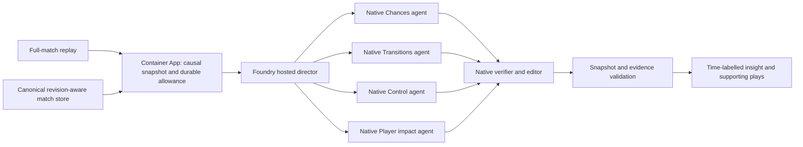

# Analyst Mode

Open **Matchday → Watch full match** to enter Analyst Mode, or use `/#analyst`.
Choose a match, press **Play match**, and select Chances, Build-up, Transitions,
or Player impact. **Your view** changes language, depth and player focus.
The statistics and spatial maps follow completed play. Rewinding clears later
findings. The existing Footie assistant and Match Centre remain available.

## Run locally

```sh
cd frontend
npm ci
npm run build
cd ..
.venv/bin/python scripts/run_analyst_local.py --port 8018
```

Open `http://127.0.0.1:8018/#analyst`. With no native configuration this is a
**metrics-only** preview: match signals are calculated, and no agents or paid
model calls are simulated. Native setup is documented in
[analyst-foundry.md](analyst-foundry.md). Native configuration belongs in private
server settings, never a browser build or source-controlled file.

After a verified native deployment and Azure CLI sign-in, the same local UI can
use it explicitly:

```sh
.venv/bin/python scripts/run_analyst_local.py --foundry-config var/analyst-activation-private.json
```

This opt-in uses the shared local allowance ledger and incurs bounded model and
hosted-session usage. Do not mark an activation file verified until the live
protocol, permission, cleanup and quality checks have passed.

## Execution boundary



Statistics and evidence-backed interpretation candidates are deterministic.
Native specialists examine compact, immutable snapshots and select the most
useful supported interpretation for their role and the viewer's preferences.
Four specialists run with bounded concurrency, followed by a fifth verification
and editorial selection call. They do not inspect video pixels or calculate
replacement statistics. The native director and the application independently
require the published reading to exactly match a candidate from that snapshot.
This protects the actor, window, units and requested language; the editor cannot
authorize arbitrary rewritten prose simply by attaching valid citation IDs.

This is bounded AI analysis: agents prioritize supported football patterns and
their significance, rather than inventing new tactical hypotheses. Candidate
coverage and the correctness of their underlying rules remain limitations to
evaluate. A model-based usefulness check is not a mathematical guarantee of
football interpretation. The earlier free-prose approach failed live semantic
checks; its results remain in the verification record.

The UI samples statistics at 15-second source-clock boundaries and requests
analysis at one-minute boundaries while playing and visible. Requests share a
durable result by snapshot, preferences and pinned native manifest. A slow result
may finish during forward playback; a rewind, correction, match change or changed
view invalidates it. The source clock is displayed with each finding.

## Spending and failure behavior

The user-authorized project envelope is **US$200 total**. The existing Azure alert
budget was updated to US$200 without changing its end date or notifications.
Alerts do not shut down resources. The Analyst pilot independently reserves a
conservative **US$0.10 per run**, with **US$30 lifetime**, **120 runs/hour**,
**200/day**, and **two concurrent runs**. Each run permits at most five native
model calls. Failed, timed-out or unreported attempts are not refunded.
Spells with no supported interpretation return without reserving spend or
starting a hosted session.

Native sessions have a two-minute idle timeout, one admitted run per session,
explicit stop/delete cleanup, pinned agent versions and bounded input/output.
The public app requires durable Cosmos admission before native activation.
Storage/configuration failures leave deterministic statistics available and do
not enable unlimited model calls. Existing Footie allowances are separate and
unchanged. These reservations are protective estimates, not billed usage.

## Metric coverage

See [analyst-metrics.md](analyst-metrics.md) for definitions and coverage. Passing,
shots, scoring, progression, involvement, activity maps and explicitly labelled
indices are available from the current events. Authored ball speed and source
probabilities require source telemetry. Continuous player distance/speed/sprints,
true possession time, video auto-eventing accuracy and missing authoritative
disciplinary categories remain unavailable with the current canonical input.
No animation-derived positions are presented as measured tracking.

The three existing GI full matches are supported. The fourth career showcase is
not advertised as a full replay until its replay adapter has parity.

## Deployment

The existing protected-main CI and exact-commit deployment gate remain in force.
The deploy workflow adds a separate `analyst_mode` input. `preserve` is the
default; `disable` leaves the existing Footie model configuration intact.
`enable` requires a private, verified native manifest and the required invocation
permissions. A mocked local test or agent registration alone is insufficient
evidence to enable the native production path.
