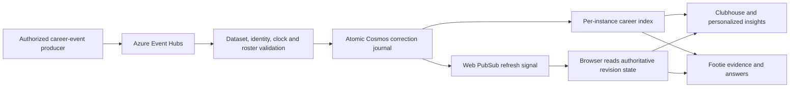

# Live career corrections

The local implementation connects Event Hubs career deliveries to the same
validated statistics used by Clubhouse, personalized insights and Footie. It is
opt-in and has not been enabled in the hosted app.

## Data path



The original, checksum-verified dataset remains immutable. The journal contains
only new actions and corrections, pinned to the ledger SHA-256. Local development
uses a separate SQLite journal. Cloud mode reuses the existing Cosmos `histories`
container, partitioned by `/scenario_id`, under `career-<ledger SHA-256>`. It needs
point reads and transactional creates/replaces, already supported by the existing
role; it does not need queries, a new database or a new Azure service.

Every compound API read refreshes its local index under a lock. Corrections use
the existing reducers, including occurrence time, revision availability,
retractions and source-sequence cutoffs. Profile totals, match history, standings,
spatial analytics and personalized cards share this revision view. Footie rereads
the durable view after narrative selection so a correction during a model request
cannot pair old prose with new numbers.

## Delivery and recovery contract

`counterpress.streaming.contracts.CareerDelivery` is a separate `career.events`
version-1 envelope with `dataset`, `delivery_id`, `match_id` and 1–32 canonical
career `Action` records. Existing scenario `Event` envelopes remain supported.
There is no implicit conversion between the two event models and no public write
endpoint. Deliveries are bounded to 240,000 bytes and routed by match ID.

Commit order is **durable journal → notification → Event Hubs checkpoint**.
Retries after a notification or checkpoint failure re-emit the signal; identical
event revisions are not counted twice. Conflicting identities, chronology,
actors, dataset or routing are quarantined before checkpointing. Storage outages
and missing bridge configuration retry without checkpointing. A Cosmos ETag
conflict rebuilds the update against the winning commit. Independent SQLite
writers serialize through `BEGIN IMMEDIATE`.

The journal is intentionally bounded below the Cosmos 2 MB item/batch limit
(1.8 MB). A full journal rejects further deliveries through quarantine. Segment
storage and add capacity monitoring before continuous, high-volume production
use. This is a correction bridge over a bounded fixture registry, not arbitrary
new-match ingestion or automatic video event extraction.

## Browser behavior

`GET /api/data/revisions` provides the dataset, generation and affected-match
revision counts. `GET /api/data/revisions/negotiate` issues a five-minute,
receive-only Web PubSub token for that dataset. The token is never persisted.
Negotiation shares the existing process rate limit.

Push messages contain refresh hints, never statistic values. A successful
revision poll is required before the browser invalidates views. A 15-second
foreground heartbeat and visibility/resume check recover missed notifications.
Unchanged club/player directories and unrelated replay widgets stay mounted;
profile controls and favorites remain in place. Corrected Clubhouse highlights
stop rendering their original source: the existing replay API returns 409 until
an updated replay is authored. Footie clears outdated conversation answers and
cancels in-flight responses without automatically invoking the model.

The legacy Matchday scenario replay and Match Centre archive readers keep their
existing independent source contracts. This change does **not** regenerate those
animations, rewrite archive fixtures or claim that every replay is dynamically
rebuilt from the career journal. Do not interpret a career correction as a
lossless update to those separate feeds.

## Local verification

From the repository root:

```sh
.venv/bin/python scripts/check_career_bridge.py
.venv/bin/pytest -q tests/test_career_streaming.py
npm --prefix frontend test -- --run src/football/revisions.test.tsx src/assistant/Footie.test.tsx
```

The smoke check uses isolated temporary journals and separate writer/reader
instances. It verifies Mateo's career goals as **75 → 74 → 75**, duplicate
suppression, and restart recovery. It does not change the fixture data or call
Azure/the AI model.

To start a local browser preview with durable corrections enabled:

```sh
COUNTERPRESS_CAREER_STREAMING=on \
COUNTERPRESS_CAREER_JOURNAL_PATH=var/career-corrections.sqlite3 \
.venv/bin/python scripts/run_footie_local.py --port 8018
```

Open `http://127.0.0.1:8018/#football/player/rh09` or
`http://127.0.0.1:8018/#assistant`. This does not start an Event Hubs consumer;
authorized local tooling can call `DataStore.ingest` against that same journal.
An unchanged journal deliberately produces no visual refresh.

Use a separate local materialized index per app process (the default is memory).
If an old profile database contains local-only revisions, migrate those revisions
into the shared journal first, or choose a fresh index. Startup/read validation
will reject divergence rather than silently discard the old revisions. Keep the
journal when restarting: deleting it is not an undo mechanism. Restore an event
with a higher revision and later availability instead.

## Cloud activation, still pending

Deploy and validate the code before setting `COUNTERPRESS_CAREER_STREAMING=on`
on the existing Cosmos/Event Hubs app. All consumers must support the contract
before sending career events. Keep the existing managed-identity configuration;
no keys or service endpoints belong in a delivery file.

An authorized producer can preflight a locally prepared envelope:

```sh
.venv/bin/python -m counterpress.streaming.send_career /path/to/delivery.json
```

It makes no cloud calls unless `--send` is explicitly supplied. Preflight checks
the immutable local dataset; the consumer also validates against already
committed revisions. Before a production rollout, verify one isolated correction
and restoration through actual Event Hubs, Cosmos, Web PubSub and the browser.
Local transactional doubles verify conflict semantics, not Azure availability or
live RBAC. Hosted activation and this end-to-end cloud check remain pending.
