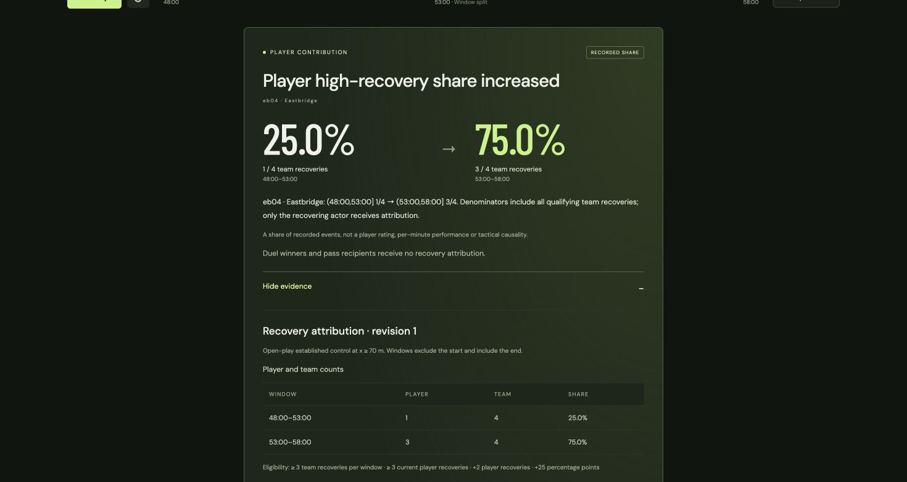

# Player contribution publication and replay — Stage 8, sixth increment

Player high-recovery shares now have durable, independent publication histories
and bilingual replay cards. They use the existing [attribution detector](contributions.md)
without changing its thresholds or crediting duel winners and pass recipients.

## Try the interface

Start the API and frontend using the [README](../README.md). Select **Player
recovery share increase**, then **Go to comparison**. The card shows `eb04` with
1/4 (25%) then 3/4 (75%) of Eastbridge's high recoveries. The **Player recovery
share control** has no eligible increase. The original independent feeds are used
unchanged; there is no time scaling or hidden generator input.

**Show evidence** displays both player counts and full team denominators, eligibility
thresholds and exact event revisions. Source rows distinguish **Attributed to this
player** from **Team denominator only**. Expanding a row shows its recorded actor,
position, occurrence time and revision availability. Analysts can also inspect the
publication's evidence identity and rule version.

Switch to Chinese or the casual view; fractions remain unchanged. Selecting `eb09`
produces no qualifying player story even though that player wins the preceding
duels. A card budget of zero hides the card. **Player recovery share** under Metric
focus gives this metric priority when other stories qualify.



## Corrections and historical replay

Use the same database as the API:

```sh
UV_CACHE_DIR=.uv-cache uv run --frozen python -m counterpress.ingest contribution-increase fixtures/contributions/publication_corrections.json
```

| Availability | Source observation | Player publication |
| --- | --- | --- |
| 58:00 | Original actors and positions | Create r1: 1/4 → 3/4 |
| 58:02 | First recovery position becomes x=70.5, with adjacent geometry corrected | Update r2: counts unchanged, exact source references revised |
| 58:05 | Transfer `c3-recovery` and related possession actions to `eb08` | Withdraw r3: 1/4 → 2/4 falls below eligibility |
| 58:10 | Transfer `c2-recovery` to `eb08` | Remain withdrawn; no repeated tombstone |
| 58:15 | Restore both recovering actors | Create r4: 1/4 → 3/4 |

The first four corrections preserve ball continuity; subsequent actor/recipient
corrections preserve player possession. The older `actor_corrections.json` still
provides the standalone detector control; use the publication file above for the
full update/withdraw/restore demonstration on a fresh history. These two alternative
batches reuse source identities and should not both be ingested into one history.

The paused browser discovers the extended horizon without advancing its playhead.
Seek to each cutoff explicitly. Withdrawal removes the card and open evidence;
restoration uses the same insight/evidence IDs with a higher publication revision.
With a player selected, the withdrawal message applies only to that player's
stream. Seeking back to 58:00 retains original actors and source revision 1.

Repeated ingestion is idempotent. Invalid batches roll back source and publication
writes together. A withdrawal freezes the evidence that caused it; later still-
ineligible observations do not create repeated tombstones. The standalone candidate
endpoint can still report those later observed counts.

## Persistence, cooldown and API

SQLite adds `contribution_changes` and `contribution_checkpoints` tables. Each
publication is keyed by scenario, insight ID and revision, with a separate ordinal
for delivery order. On first access, older histories backfill contributions at
their historical observation cutoffs and save a source-count checkpoint. Existing
source, recovery, pressure and model workflow histories remain unchanged. Restart
and old-schema tests work without the original fixture files.

Stable IDs include match, subject team, player, metric, rule version and both
comparison windows. The default 60-second cooldown applies only to new comparisons
for the same match, team, player, metric and rule version. Another player, team or match is independent; future
publications cannot suppress current evidence. Exactly 60 seconds ends cooldown.
An existing comparison's corrections bypass cooldown so updates, withdrawal and
restoration are immediate. Current demo scenarios use one fixed window pair;
distinct-window cooldown behavior is covered separately by detector projection tests.

Snapshots add `contribution`, `contribution_lifecycle`, and
`selected_kind="contribution"`. The lifecycle includes the latest available
publication for every player stream, including withdrawal tombstones. Frozen
evidence, including the evidence behind a withdrawal, is available through:

```text
GET /api/scenarios/{scenario}/contributions/{insight_id}/evidence/{revision}?at_ms={cutoff}
```

The route checks scenario, ID, revision and cutoff and returns 404 if unavailable.
It sends `Cache-Control: no-store`. The original per-player candidate route remains
available and recomputes from canonical persisted sources.

The browser checks narrative identity, revision, player preference, language,
depth and publication availability against the authoritative lifecycle. It retains
a separate revision watermark for every player stream, rejecting missing or stale
streams during forward playback. Intentional seeks, viewer changes and preference
changes start fresh scopes, allowing valid historical evidence.

## Shared card budget and limitations

Contribution, recovery and pressure candidates share the zero-or-one card budget.
Base priority is 10, with +20 for the preferred club, +30 for a matching selected
player and +10 for matching metric focus; other non-balanced focuses subtract 5.
Contribution candidates require the selected player to be the actual subject.
Existing recovery then pressure stories win equal-priority cross-metric ties;
contribution ties sort by player and stable insight ID. Preferences never rewrite
authoritative evidence.

Wording is deterministic in English and Simplified Chinese. No model request or
Azure credential is involved. The metric remains a share of recorded open-play
recoveries, not a player rating, minutes-adjusted performance or tactical causality.

All 368 backend tests and 27 frontend tests pass, along with the production build.
Browser review confirmed the evidence table, language switching, selected-player
exclusion, historical update/withdraw/restore and the negative control. Review used
an isolated ignored database; its temporary tab and servers were closed. Exact
commands, output and changed files are in [progress](progress.md).

Best next move: evidence-linked match recaps using the available published stories
and their revisions. Broader attribution rules and Azure application deployment
remain later work.
