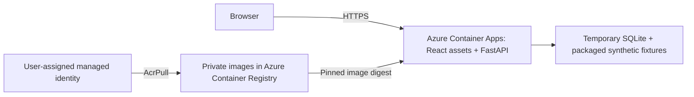

# Container and Azure deployment foundation

Stage 9 increment 1 packages the working app and provides Azure Bicep templates.
The container is verified locally and in GitHub Actions. Azure Container Apps,
the private registry and managed identity are deployed in the existing model
resource group in East US. The USD 75 budget and trial spending limit are verified.
See the latest progress entry for hosted verification evidence. The existing Azure OpenAI model calls were
verified separately. They are not enabled by this deployment template.

## Local container

Requires Docker with a running engine. From the repository root:

```sh
docker build --platform linux/amd64 -t counterpress:smoke .
bash scripts/test_container.sh
```

The smoke script starts a disposable container on a random loopback port, checks
real HTTP responses and stops/removes the container. It runs with a read-only root,
dropped capabilities, no new privileges, 0.5 CPU and 1 GiB memory. Only temporary
`/data` and `/tmp` are writable. No environment file or model credential is passed.

For an interactive local demo:

```sh
docker run --rm --platform linux/amd64 --name counterpress-demo \
  --read-only --cap-drop ALL --security-opt no-new-privileges \
  --tmpfs /data:uid=10001,gid=10001,mode=0700 --tmpfs /tmp:mode=1777 \
  -p 127.0.0.1:8000:8000 counterpress:smoke
```

Open `http://127.0.0.1:8000`. Stop with Ctrl+C. Database contents disappear when
the container is removed. Do not use the temporary storage for valued match data.
The image has one Uvicorn worker; it is not ready for multiple application replicas.

The Dockerfile uses digest-pinned Node 24 and Python 3.13 base images, uv 0.11.29,
committed lockfiles and separate build stages. Review/update image digests for
security updates. The runtime contains the installed Python package, curated
synthetic fixtures and compiled frontend. It runs as UID/GID 10001. The allowlist
in `.dockerignore` excludes private configuration before context transfer; no
credential build argument, secret mount or environment file is needed.

FastAPI serves `/` and `/assets` on the API origin. Other paths retain their normal
404 responses; source directories are not mounted. `COUNTERPRESS_STATIC_DIR`
enables this mode and must contain `index.html` and `assets/`; development leaves
it unset and uses Vite. Container paths are explicit:

| Setting | Container value |
| --- | --- |
| `COUNTERPRESS_STATIC_DIR` | `/app/static` |
| `COUNTERPRESS_FIXTURE_DIR` | `/app/fixtures` |
| `COUNTERPRESS_DB_PATH` | `/data/counterpress.sqlite3` |

`/health` checks process liveness. `/ready` loads the initial recovery replay from
local storage, returning a sanitized 503 on failure. It can seed the fixture on
first use. Neither endpoint contacts Azure. Initial `/ready` success does not
replace the all-scenario regression suite or the real HTTP smoke test.

## Deployed Azure architecture



This diagram describes the deployed demo. The registry
uses Basic SKU with admin credentials disabled. Its network endpoint is public,
but image access requires authorization. A managed identity has only `AcrPull` on
this registry. The application uses external HTTPS ingress, explicit target port
8000, startup/readiness/liveness probes, Consumption profile, minimum zero and
maximum one replica, and single active revision mode.

Container filesystem storage is temporary: scaling to zero, recycling or replacing
a revision can discard the SQLite journal, corrections and model audits. A new
container reseeds packaged synthetic fixtures. Even one replica per revision is
not a shared-state guarantee during rollout. This is a deterministic demo smoke
stage; Cosmos DB durability must precede streaming ingestion and production use.
Microsoft documents [storage lifetimes](https://learn.microsoft.com/en-us/azure/container-apps/storage-mounts),
[managed-identity image pulls](https://learn.microsoft.com/en-us/azure/container-apps/managed-identity-image-pull)
and [probe behavior](https://learn.microsoft.com/en-us/azure/container-apps/health-probes).

## Deployment sequence after target and cost review

Before running Azure commands, choose a subscription, supported region, resource
group and monthly budget. The user has chosen to reuse the group containing the
existing model deployment. Keep its resolved subscription/resource identifiers in
ignored local configuration, not in this public runbook. Registry storage has
ongoing cost even when the
app scales to zero; application use, networking and later services can add charges.
Azure budget alerts are notifications, not a hard spending stop. The environment uses Azure Monitor routing without a diagnostic sink or paid
Log Analytics workspace; logs are not centrally retained yet.
Estimate the chosen region's costs and configure budget alerts before provisioning.
Use the [Azure pricing calculator](https://azure.microsoft.com/en-us/pricing/calculator/)
and [budget guidance](https://learn.microsoft.com/en-us/azure/cost-management-billing/costs/tutorial-acm-create-budgets).

The following is a reproducible manual runbook, **not a CI deployment workflow**.
The initial deployment has completed; do not rerun it just to view the demo.
Use Azure CLI with Bicep and Docker. Sign in locally, and keep account identifiers
in local shell variables. Do not commit resolved parameter files or command logs.
The deploying identity needs resource creation rights and permission to assign the
registry-scoped `AcrPull` role (Contributor alone does not grant role assignments).

```sh
az login
read -r -p 'Subscription ID: ' CP_SUBSCRIPTION
read -r -p 'Region: ' CP_REGION
read -r -p 'Existing model resource group name: ' CP_GROUP
az account set --subscription "$CP_SUBSCRIPTION"
az group show --name "$CP_GROUP" --query '{name:name,location:location}'
az resource list --resource-group "$CP_GROUP" --query '[].{name:name,type:type}' --output table
az deployment group what-if --resource-group "$CP_GROUP" \
  --template-file infra/foundation.bicep --parameters location="$CP_REGION"
```

These `read -p` examples use Bash. Inspect existing resources for name collisions,
the incremental what-if changes,
cost estimate and target before deployment. Reusing a resource group does not
reuse model compute or make hosting free. Do not use complete deployment mode,
delete the group, or modify the existing model resource. A resource group's metadata
location can differ from its resources; pass the chosen app region explicitly.
Resource provider registration may be needed
for `Microsoft.App`, `Microsoft.ContainerRegistry`, `Microsoft.ManagedIdentity`
and `Microsoft.Insights`.

Create the budget before hosting. Keep `amount`, `startDate`, `endDate` and the
private `contactEmail` in an ignored local ARM parameters file; the approved
values are USD 75, 2026-10-01T00:00:00Z and 2026-11-14T00:00:00Z.

```sh
az deployment group create --name counterpress-budget --resource-group "$CP_GROUP" \
  --template-file infra/budget.bicep --mode Incremental \
  --parameters @var/azure-budget.parameters.json --output none
az deployment group create --name counterpress-foundation --resource-group "$CP_GROUP" \
  --template-file infra/foundation.bicep --mode Incremental --parameters location="$CP_REGION" --output none
CP_REGISTRY=$(az deployment group show --name counterpress-foundation --resource-group "$CP_GROUP" \
  --query properties.outputs.registryName.value --output tsv)
CP_LOGIN_SERVER=$(az acr show --name "$CP_REGISTRY" --query loginServer --output tsv)
az acr login --name "$CP_REGISTRY" --output none
CP_TAG=$(git rev-parse HEAD)
docker build --platform linux/amd64 -t "${CP_LOGIN_SERVER}/counterpress:${CP_TAG}" .
bash scripts/test_container.sh "${CP_LOGIN_SERVER}/counterpress:${CP_TAG}"
docker push "${CP_LOGIN_SERVER}/counterpress:${CP_TAG}"
CP_DIGEST=$(az acr repository show --name "$CP_REGISTRY" \
  --image "counterpress:${CP_TAG}" --query digest --output tsv)
az deployment group what-if --resource-group "$CP_GROUP" \
  --template-file infra/app.bicep --parameters location="$CP_REGION" imageDigest="$CP_DIGEST"
```

Check the second what-if, then deploy the exact digest:

```sh
az deployment group create --name counterpress-application --resource-group "$CP_GROUP" \
  --template-file infra/app.bicep --mode Incremental --parameters location="$CP_REGION" imageDigest="$CP_DIGEST" --output none
CP_HOST=$(az containerapp show --name counterpress --resource-group "$CP_GROUP" \
  --query properties.configuration.ingress.fqdn --output tsv)
python3 scripts/container_smoke.py "https://${CP_HOST}"
```

Use the same `namePrefix` parameter in both templates if overriding `counterpress`.
Wait for registry role assignment propagation if the first image pull fails;
inspect revision status without printing any credentials. Compilation in CI is
syntax/type validation, not proof that a subscription permits the region, quotas,
roles or deployment. Azure what-if and live verification are still required.

To roll back code, redeploy `infra/app.bicep` with a previously tested image digest;
this does not restore temporary database changes. For cleanup in the shared
group, first review the exact resources created by the
CounterPress deployments and their dependencies. Remove only those app,
environment, registry, identity and registry-scoped role-assignment resources
when authorized; never delete the shared group or the existing model resource.
Resource deletion is not part of CI.

## Approved hackathon cost envelope

The user approved USD 75 total across the remaining trial, with a USD 50–60 target under
light development/demo use. This is a spending envelope, not a prepaid purchase
or a guarantee. Allocate USD 20 to hosting/registry, USD 20 to streaming, USD 10
to model calls, USD 5 to storage/monitoring/networking, and USD 20 contingency.
Create streaming resources only when needed; their full-month cost can consume
their allocation. Review actual spend before each new service.
Use Web PubSub Free while its connection/message limits meet the demo's needs.

For cost context, the public Azure retail API in East US on 16 October 2026
reported ACR Basic at USD 0.1666/day and Event Hubs Standard at USD 0.03 per
throughput-unit hour (about USD 21.90 for 730 hours with one unit, plus ingress).
Cosmos DB serverless requests were USD 0.25 per million RUs, plus storage.
These are unit rates, not measured CounterPress workload costs; credits,
subscription entitlements and usage determine actual billing. See the
[retail pricing API](https://learn.microsoft.com/en-us/rest/api/cost-management/retail-prices/azure-retail-prices),
[Container Apps free grants](https://azure.microsoft.com/en-us/pricing/details/container-apps/)
and [Web PubSub Free limits](https://azure.microsoft.com/en-us/pricing/details/web-pubsub/).
The Cosmos adapter must account for RU consumption from repeated snapshot reads;
caching and later revision push delivery should avoid rereading full histories
on every viewer poll.

Keep scale-to-zero enabled, close replay tabs when unused (polling keeps sending
requests), and start streaming capacity only when needed. Continuous workers and
load tests can exceed the light-use estimates. Track model evaluation calls and
log ingestion, and avoid unnecessary paid add-ons. Keep the trial spending limit
in place; do not upgrade or remove it as part of deployment. Some Marketplace
items are excluded from credits; see [spending-limit details](https://learn.microsoft.com/en-us/azure/cost-management-billing/manage/spending-limit).

Track cumulative project cost across calendar months through the actual trial
expiry; a monthly budget reset must not authorize another USD 75. Configure
alerts well before the envelope is exhausted and review cost data regularly:
Azure alerts are delayed notifications, not automatic shutdown. Preserve an
exported demo before trial expiry, and make a separate decision about hosting
needed after the credits expire. `infra/budget.bicep` uses quarterly tracking with an explicit trial-end date to
avoid a November monthly reset. Its contact address is a secure parameter loaded
from ignored local configuration. Actual-cost alerts trigger at 50%, 75%, 90%
and 100%, with a forecast alert at 100%. Deployment status is in the progress log.

## Next integration steps

1. Add Cosmos DB persistence with atomic source/evidence/publication commits and
   restart tests before replacing the SQLite demo store.
2. Add Event Hubs partitioned by match ID and Web PubSub revision delivery/reconnect.
3. Add Entra workload identities and protected GitHub environment/OIDC deployment,
   then operational telemetry. Model endpoint/configuration stays server-side;
   credentials or private endpoints must never enter frontend builds, public
   outputs, image layers or committed files.

Current CI only builds, tests and compiles templates. It does not push an image,
create Azure resources or use cloud credentials. The full architecture review
and Microsoft-platform extension proposal follow completion of Stages 9 and 10.
