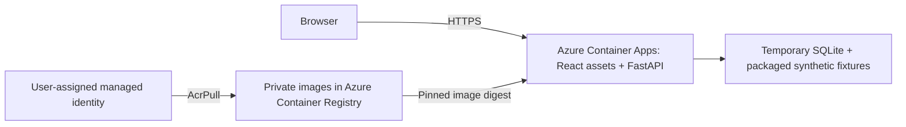

# Container and Azure deployment foundation

Stage 9 increment 1 packages the working app and provides Azure Bicep templates.
The container is verified locally and in GitHub Actions; **Azure application
resources have not been deployed**. The existing Azure OpenAI model calls were
verified separately. They are not enabled by this deployment template.

## Local container

Requires Docker with a running engine. From the repository root:

```sh
docker build --platform linux/amd64 -t counterpress:smoke .
bash scripts/test_container.sh
```

The smoke script starts a disposable container on a random loopback port, checks
real HTTP responses and stops/removes the container. It runs with a read-only root,
dropped capabilities, no new privileges, 0.5 CPU and 1 GiB memory. Only temporary
`/data` and `/tmp` are writable. No environment file or model credential is passed.

For an interactive local demo:

```sh
docker run --rm --platform linux/amd64 --name counterpress-demo \
  --read-only --cap-drop ALL --security-opt no-new-privileges \
  --tmpfs /data:uid=10001,gid=10001,mode=0700 --tmpfs /tmp:mode=1777 \
  -p 127.0.0.1:8000:8000 counterpress:smoke
```

Open `http://127.0.0.1:8000`. Stop with Ctrl+C. Database contents disappear when
the container is removed. Do not use the temporary storage for valued match data.
The image has one Uvicorn worker; it is not ready for multiple application replicas.

The Dockerfile uses digest-pinned Node 24 and Python 3.13 base images, uv 0.11.29,
committed lockfiles and separate build stages. Review/update image digests for
security updates. The runtime contains the installed Python package, curated
synthetic fixtures and compiled frontend. It runs as UID/GID 10001. The allowlist
in `.dockerignore` excludes private configuration before context transfer; no
credential build argument, secret mount or environment file is needed.

FastAPI serves `/` and `/assets` on the API origin. Other paths retain their normal
404 responses; source directories are not mounted. `COUNTERPRESS_STATIC_DIR`
enables this mode and must contain `index.html` and `assets/`; development leaves
it unset and uses Vite. Container paths are explicit:

| Setting | Container value |
| --- | --- |
| `COUNTERPRESS_STATIC_DIR` | `/app/static` |
| `COUNTERPRESS_FIXTURE_DIR` | `/app/fixtures` |
| `COUNTERPRESS_DB_PATH` | `/data/counterpress.sqlite3` |

`/health` checks process liveness. `/ready` loads the initial recovery replay from
local storage, returning a sanitized 503 on failure. It can seed the fixture on
first use. Neither endpoint contacts Azure. Initial `/ready` success does not
replace the all-scenario regression suite or the real HTTP smoke test.

## Prepared Azure architecture



This diagram describes the templates, not an already deployed system. The registry
uses Basic SKU with admin credentials disabled. Its network endpoint is public,
but image access requires authorization. A managed identity has only `AcrPull` on
this registry. The application uses external HTTPS ingress, explicit target port
8000, startup/readiness/liveness probes, Consumption profile, minimum zero and
maximum one replica, and single active revision mode.

Container filesystem storage is temporary: scaling to zero, recycling or replacing
a revision can discard the SQLite journal, corrections and model audits. A new
container reseeds packaged synthetic fixtures. Even one replica per revision is
not a shared-state guarantee during rollout. This is a deterministic demo smoke
stage; Cosmos DB durability must precede streaming ingestion and production use.
Microsoft documents [storage lifetimes](https://learn.microsoft.com/en-us/azure/container-apps/storage-mounts),
[managed-identity image pulls](https://learn.microsoft.com/en-us/azure/container-apps/managed-identity-image-pull)
and [probe behavior](https://learn.microsoft.com/en-us/azure/container-apps/health-probes).

## Deployment sequence after target and cost review

Before running Azure commands, choose a subscription, supported region, dedicated
resource group and monthly budget. Registry storage has ongoing cost even when the
app scales to zero; application use, networking and later services can add charges.
Azure budget alerts are notifications, not a hard spending stop. There is no paid
Log Analytics workspace in these templates; logs are not centrally retained yet.
Estimate the chosen region's costs and configure budget alerts before provisioning.
Use the [Azure pricing calculator](https://azure.microsoft.com/en-us/pricing/calculator/)
and [budget guidance](https://learn.microsoft.com/en-us/azure/cost-management-billing/costs/tutorial-acm-create-budgets).

The following is a manual runbook, **not an automatically executed workflow**.
Use Azure CLI with Bicep and Docker. Sign in locally, and keep account identifiers
in local shell variables. Do not commit resolved parameter files or command logs.
The deploying identity needs resource creation rights and permission to assign the
registry-scoped `AcrPull` role (Contributor alone does not grant role assignments).

```sh
az login
read -r -p 'Subscription ID: ' CP_SUBSCRIPTION
read -r -p 'Region: ' CP_REGION
read -r -p 'New dedicated resource group name: ' CP_GROUP
az account set --subscription "$CP_SUBSCRIPTION"
az group create --name "$CP_GROUP" --location "$CP_REGION" --output none
az deployment group what-if --resource-group "$CP_GROUP" \
  --template-file infra/foundation.bicep
```

These `read -p` examples use Bash. Inspect the resource changes, cost estimate and
target before the create command. Resource provider registration may be needed
for `Microsoft.App`, `Microsoft.ContainerRegistry`, and `Microsoft.ManagedIdentity`.

```sh
az deployment group create --name foundation --resource-group "$CP_GROUP" \
  --template-file infra/foundation.bicep --output none
CP_REGISTRY=$(az deployment group show --name foundation --resource-group "$CP_GROUP" \
  --query properties.outputs.registryName.value --output tsv)
CP_LOGIN_SERVER=$(az acr show --name "$CP_REGISTRY" --query loginServer --output tsv)
az acr login --name "$CP_REGISTRY" --output none
CP_TAG=$(git rev-parse HEAD)
docker build --platform linux/amd64 -t "${CP_LOGIN_SERVER}/counterpress:${CP_TAG}" .
bash scripts/test_container.sh "${CP_LOGIN_SERVER}/counterpress:${CP_TAG}"
docker push "${CP_LOGIN_SERVER}/counterpress:${CP_TAG}"
CP_DIGEST=$(az acr repository show --name "$CP_REGISTRY" \
  --image "counterpress:${CP_TAG}" --query digest --output tsv)
az deployment group what-if --resource-group "$CP_GROUP" \
  --template-file infra/app.bicep --parameters imageDigest="$CP_DIGEST"
```

Check the second what-if, then deploy the exact digest:

```sh
az deployment group create --name application --resource-group "$CP_GROUP" \
  --template-file infra/app.bicep --parameters imageDigest="$CP_DIGEST" --output none
CP_HOST=$(az containerapp show --name counterpress --resource-group "$CP_GROUP" \
  --query properties.configuration.ingress.fqdn --output tsv)
python3 scripts/container_smoke.py "https://${CP_HOST}"
```

Use the same `namePrefix` parameter in both templates if overriding `counterpress`.
Wait for registry role assignment propagation if the first image pull fails;
inspect revision status without printing any credentials. Compilation in CI is
syntax/type validation, not proof that a subscription permits the region, quotas,
roles or deployment. Azure what-if and live verification are still required.

To roll back code, redeploy `infra/app.bicep` with a previously tested image digest;
this does not restore temporary database changes. Remove the dedicated demo
resource group through Azure when the demo is no longer needed, after confirming
it contains no shared resources. Resource deletion is not part of CI.

## Next integration steps

1. Confirm the Azure target/budget and perform the hosted smoke check above.
2. Add Cosmos DB persistence with atomic source/evidence/publication commits and
   restart tests before replacing the SQLite demo store.
3. Add Event Hubs partitioned by match ID and Web PubSub revision delivery/reconnect.
4. Add Entra workload identities and protected GitHub environment/OIDC deployment,
   then operational telemetry. Model endpoint/configuration stays server-side;
   credentials or private endpoints must never enter frontend builds, public
   outputs, image layers or committed files.

Current CI only builds, tests and compiles templates. It does not push an image,
create Azure resources or use cloud credentials. The full architecture review
and Microsoft-platform extension proposal follow completion of Stages 9 and 10.
