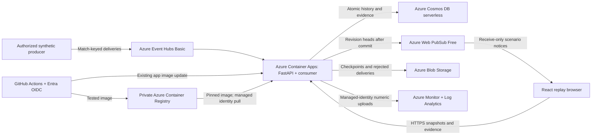

# Container and Azure deployment foundation

Stage 9 increment 1 packages the working app and provides Azure Bicep templates.
The container is verified locally and in GitHub Actions. Azure Container Apps,
the private registry and managed identity are deployed in the existing model
resource group in East US. Shared history uses serverless Cosmos DB in East US 2,
with a separate managed identity; East US database creation was capacity-blocked.
Event Hubs Basic, Web PubSub Free and Blob checkpoints are now deployed in East US.
The USD 75 budget and trial spending limit are verified.
See the latest progress entry for hosted verification evidence. The existing Azure OpenAI model calls were
verified separately. They are not enabled by this deployment template.

## Local container

Requires Docker with a running engine. From the repository root:

```sh
docker build --platform linux/amd64 -t counterpress:smoke .
bash scripts/test_container.sh
```

The smoke script starts a disposable container on a random loopback port, checks
real HTTP responses and stops/removes the container. It runs with a read-only root,
dropped capabilities, no new privileges, 0.5 CPU and 1 GiB memory. Only temporary
`/data` and `/tmp` are writable. No environment file or model credential is passed.

For an interactive local demo:

```sh
docker run --rm --platform linux/amd64 --name counterpress-demo \
  --read-only --cap-drop ALL --security-opt no-new-privileges \
  --tmpfs /data:uid=10001,gid=10001,mode=0700 --tmpfs /tmp:mode=1777 \
  -p 127.0.0.1:8000:8000 counterpress:smoke
```

Open `http://127.0.0.1:8000`. Stop with Ctrl+C. Database contents disappear when
the container is removed. Do not use the temporary storage for valued match data.
The image has one Uvicorn worker; it is not ready for multiple application replicas.

The Dockerfile uses digest-pinned Node 24 and Python 3.13 base images, uv 0.11.29,
committed lockfiles and separate build stages. Review/update image digests for
security updates. The runtime contains the installed Python package, curated
synthetic fixtures and compiled frontend. It runs as UID/GID 10001. The allowlist
in `.dockerignore` excludes private configuration before context transfer; no
credential build argument, secret mount or environment file is needed.

FastAPI serves `/` and `/assets` on the API origin. Other paths retain their normal
404 responses; source directories are not mounted. `COUNTERPRESS_STATIC_DIR`
enables this mode and must contain `index.html` and `assets/`; development leaves
it unset and uses Vite. Container paths are explicit:

| Setting | Container value |
| --- | --- |
| `COUNTERPRESS_STATIC_DIR` | `/app/static` |
| `COUNTERPRESS_FIXTURE_DIR` | `/app/fixtures` |
| `COUNTERPRESS_DB_PATH` | `/data/counterpress.sqlite3` |

`/health` checks process liveness. `/ready` loads the initial recovery replay from
the configured store, returning a sanitized 503 on failure. It can seed the fixture
on first use. In Cosmos mode readiness contacts Azure; in local SQLite mode neither
endpoint needs Azure. Readiness does not prove consumer progress or Web PubSub
delivery. The all-scenario suite and live transport check remain separate.

## Deployed Azure architecture



This diagram describes the deployed demo. The registry
uses Basic SKU with admin credentials disabled. Its network endpoint is public,
but image access requires authorization. A managed identity has only `AcrPull` on
this registry. The application uses external HTTPS ingress, explicit target port
8000, startup/readiness/liveness probes, Consumption profile, minimum zero and
maximum one replica, and single active revision mode.

The active hosted deployment uses `COUNTERPRESS_STORAGE=cosmos`; source history,
evidence, publication revisions and audits live outside the container. See the
[Cosmos design and runbook](cosmos.md) for atomic commits, session consistency,
the 1.8 MB per-history guard and restart verification. This is a bounded demo,
not an unbounded event store or multi-region disaster-recovery architecture.

The [streaming runbook](streaming.md) explains commit/notify/checkpoint ordering,
retry and quarantine. Separate managed identities grant the consumer receiver,
Blob and Web PubSub service access, and the explicit producer hub-only sender
access. These services use Entra authentication with local/shared-key access off.
The browser receives only a short-lived, receive-only scenario token. Push prompts
a validated HTTP snapshot; reconnect and periodic reconciliation recover missed
notifications. An Event Hubs scale rule complements HTTP scaling. Activation from
zero is configured but has not been separately measured in the live proof.

Local/default image mode still uses SQLite. In that mode, scaling to zero,
recycling or replacing a revision can discard the local journal and audits.
Do not switch a cloud deployment back to SQLite and expect to see its Cosmos
history. No automatic migration from a developer's local database is performed.
Microsoft documents [storage lifetimes](https://learn.microsoft.com/en-us/azure/container-apps/storage-mounts),
[managed-identity image pulls](https://learn.microsoft.com/en-us/azure/container-apps/managed-identity-image-pull)
and [probe behavior](https://learn.microsoft.com/en-us/azure/container-apps/health-probes).

## Deployment sequence after target and cost review

Before running Azure commands, choose a subscription, supported region, resource
group and monthly budget. The user has chosen to reuse the group containing the
existing model deployment. Keep its resolved subscription/resource identifiers in
ignored local configuration, not in this public runbook. Registry storage has
ongoing cost even when the
app scales to zero; application use, networking and later services can add charges.
Azure budget alerts are notifications, not a hard spending stop. The environment uses
Azure Monitor support; the optional [operations setup](operations.md) adds a small
Log Analytics workspace that retains only numeric streaming telemetry.
Estimate the chosen region's costs and configure budget alerts before provisioning.
Use the [Azure pricing calculator](https://azure.microsoft.com/en-us/pricing/calculator/)
and [budget guidance](https://learn.microsoft.com/en-us/azure/cost-management-billing/costs/tutorial-acm-create-budgets).

The following is a reproducible manual runbook, **not a CI deployment workflow**.
The initial deployment has completed; do not rerun it just to view the demo.
This foundation sequence defaults to SQLite; follow the Cosmos guide to retain
shared storage when deploying the app (`useCosmos=true`). The current deployment
also requires `useStreaming=true` and the reviewed streaming resource parameters;
follow the [streaming runbook](streaming.md) to retain that integration. The bare
commands below describe the initial foundation, not an update of the current app.
Use Azure CLI with Bicep and Docker. Sign in locally, and keep account identifiers
in local shell variables. Do not commit resolved parameter files or command logs.
The deploying identity needs resource creation rights and permission to assign the
registry-scoped `AcrPull` role (Contributor alone does not grant role assignments).

```sh
az login
read -r -p 'Subscription ID: ' CP_SUBSCRIPTION
read -r -p 'Region: ' CP_REGION
read -r -p 'Existing model resource group name: ' CP_GROUP
az account set --subscription "$CP_SUBSCRIPTION"
az group show --name "$CP_GROUP" --query '{name:name,location:location}'
az resource list --resource-group "$CP_GROUP" --query '[].{name:name,type:type}' --output table
az deployment group what-if --resource-group "$CP_GROUP" \
  --template-file infra/foundation.bicep --parameters location="$CP_REGION"
```

These `read -p` examples use Bash. Inspect existing resources for name collisions,
the incremental what-if changes,
cost estimate and target before deployment. Reusing a resource group does not
reuse model compute or make hosting free. Do not use complete deployment mode,
delete the group, or modify the existing model resource. A resource group's metadata
location can differ from its resources; pass the chosen app region explicitly.
Resource provider registration may be needed
for `Microsoft.App`, `Microsoft.ContainerRegistry`, `Microsoft.ManagedIdentity`
and `Microsoft.Insights`.

Create the budget before hosting. Keep `amount`, `startDate`, `endDate` and the
private `contactEmail` in an ignored local ARM parameters file; the approved
values are USD 75, 2026-10-01T00:00:00Z and 2026-11-14T00:00:00Z.

```sh
az deployment group create --name counterpress-budget --resource-group "$CP_GROUP" \
  --template-file infra/budget.bicep --mode Incremental \
  --parameters @var/azure-budget.parameters.json --output none
az deployment group create --name counterpress-foundation --resource-group "$CP_GROUP" \
  --template-file infra/foundation.bicep --mode Incremental --parameters location="$CP_REGION" --output none
CP_REGISTRY=$(az deployment group show --name counterpress-foundation --resource-group "$CP_GROUP" \
  --query properties.outputs.registryName.value --output tsv)
CP_LOGIN_SERVER=$(az acr show --name "$CP_REGISTRY" --query loginServer --output tsv)
az acr login --name "$CP_REGISTRY" --output none
CP_TAG=$(git rev-parse HEAD)
docker build --platform linux/amd64 -t "${CP_LOGIN_SERVER}/counterpress:${CP_TAG}" .
bash scripts/test_container.sh "${CP_LOGIN_SERVER}/counterpress:${CP_TAG}"
docker push "${CP_LOGIN_SERVER}/counterpress:${CP_TAG}"
CP_DIGEST=$(az acr repository show --name "$CP_REGISTRY" \
  --image "counterpress:${CP_TAG}" --query digest --output tsv)
az deployment group what-if --resource-group "$CP_GROUP" \
  --template-file infra/app.bicep --parameters location="$CP_REGION" imageDigest="$CP_DIGEST"
```

Check the second what-if, then deploy the exact digest:

```sh
az deployment group create --name counterpress-application --resource-group "$CP_GROUP" \
  --template-file infra/app.bicep --mode Incremental --parameters location="$CP_REGION" imageDigest="$CP_DIGEST" --output none
CP_HOST=$(az containerapp show --name counterpress --resource-group "$CP_GROUP" \
  --query properties.configuration.ingress.fqdn --output tsv)
python3 scripts/container_smoke.py "https://${CP_HOST}"
```

Use the same `namePrefix` parameter in both templates if overriding `counterpress`.
Wait for registry role assignment propagation if the first image pull fails;
inspect revision status without printing any credentials. Compilation in CI is
syntax/type validation, not proof that a subscription permits the region, quotas,
roles or deployment. Azure what-if and live verification are still required.

To roll back code, redeploy `infra/app.bicep` with a previously tested image digest;
preserve the current Cosmos and streaming parameters. A code rollback does not
roll back source history or Event Hubs checkpoints. For cleanup in the shared
group, first review the exact resources created by the
CounterPress deployments and their dependencies. Remove only those app,
environment, registry, identity and registry-scoped role-assignment resources
when authorized; never delete the shared group or the existing model resource.
Resource deletion is not part of CI.

## Approved hackathon cost envelope

The user approved USD 75 total across the remaining trial, with a USD 50–60 target under
light development/demo use. This is a spending envelope, not a prepaid purchase
or a guarantee. Allocate USD 20 to hosting/registry, USD 20 to streaming, USD 10
to model calls, USD 5 to storage/monitoring/networking, and USD 20 contingency.
Create streaming resources only when needed; their full-month cost can consume
their allocation. Review actual spend before each new service.
Use Web PubSub Free while its connection/message limits meet the demo's needs.

For cost context, the public Azure retail API in East US on 16 October 2026
reported ACR Basic at USD 0.1666/day. The deployed Event Hubs **Basic** tier is
USD 0.015 per throughput-unit hour: about USD 10.08 for 28 days at one TU, plus
ingress, storage and network usage. Web PubSub uses its Free tier.
Cosmos DB serverless requests were USD 0.25 per million RUs, plus storage.
These are unit rates, not measured CounterPress workload costs; credits,
subscription entitlements and usage determine actual billing. See the
[retail pricing API](https://learn.microsoft.com/en-us/rest/api/cost-management/retail-prices/azure-retail-prices),
[Container Apps free grants](https://azure.microsoft.com/en-us/pricing/details/container-apps/)
and [Web PubSub Free limits](https://azure.microsoft.com/en-us/pricing/details/web-pubsub/).
The Cosmos adapter must account for RU consumption from repeated snapshot reads;
connected revision push now reduces idle reconciliation to once per 30 seconds;
disconnected clients poll every two seconds, and playback still fetches snapshots.
Further caching may be needed as audience size grows.

Keep scale-to-zero enabled, close replay tabs when unused (polling keeps sending
requests), and start streaming capacity only when needed. Continuous workers and
load tests can exceed the light-use estimates. Track model evaluation calls and
log ingestion, and avoid unnecessary paid add-ons. Keep the trial spending limit
in place; do not upgrade or remove it as part of deployment. Some Marketplace
items are excluded from credits; see [spending-limit details](https://learn.microsoft.com/en-us/azure/cost-management-billing/manage/spending-limit).

Track cumulative project cost across calendar months through the actual trial
expiry; a monthly budget reset must not authorize another USD 75. Configure
alerts well before the envelope is exhausted and review cost data regularly:
Azure alerts are delayed notifications, not automatic shutdown. Preserve an
exported demo before trial expiry, and make a separate decision about hosting
needed after the credits expire. `infra/budget.bicep` uses quarterly tracking with an explicit trial-end date to
avoid a November monthly reset. Its contact address is a secure parameter loaded
from ignored local configuration. Actual-cost alerts trigger at 50%, 75%, 90%
and 100%, with a forecast alert at 100%. Deployment status is in the progress log.

## Next integration steps

1. Complete Stage 10 evaluation: controls, correction behavior, evidence fidelity and measured delivery behavior.
2. Prepare the final architecture review and prioritize Microsoft-platform extensions by demonstrable value and budget.

Model endpoint/configuration stays server-side; credentials or private endpoints
must never enter frontend builds, public outputs, image layers or committed files.

The `CI` workflow builds, tests and compiles templates without cloud credentials.
The separate manually dispatched `Deploy Azure` workflow uses OIDC to push an image
and update the existing app; it does not provision resources. The full architecture review
and Microsoft-platform extension proposal follow completion of Stages 9 and 10.

## Studio activation through the protected workflow

`Deploy Azure` accepts `studio_mode`: `preserve` (default), `enable`, or `disable`.
Preserve changes only the image. Enable/disable additionally change only the four
Studio identity/mode settings; all storage, streaming, telemetry, identities,
network settings and replica limits must match the reviewed expected template.
Changing Studio identity settings requires the editorial API to be off. For AI
activation, preserve Studio and use the separate editorial mode below.

Enable requires the `CP_STUDIO_IDENTITY` secret in the existing `azure-demo`
environment. Its JSON has exactly `tenant_id`, `api_client_id`, and `client_id`,
all canonical UUIDs from the single-tenant API and Studio SPA registrations.
These are identity metadata, not API keys; keep actual values out of the repo.
The workflow masks them and never uploads raw Azure responses. Normal builds
contain no environment-specific identity or model configuration.

Before enabling, complete local real-SPA sign-in and isolated live Cosmos checks
with `scripts/check_studio_cosmos.py seed` followed by `verify` in a new process.
The probe uses `verify-studio-<scope>-increase`, refuses to reset an existing
scope, records a clearly synthetic probe actor and makes no model calls. It
checks approval, revocation, correction invalidation, current export, rejected
old export and fixture-free restoration. Verification records are retained.

After merge and successful exact-main CI, dispatch the reviewed mode:

```sh
gh workflow run deploy.yml --repo Haydnlee31/CounterPress --ref main -f studio_mode=enable
```

The HTTPS smoke checks that anonymous review, approval, revocation and export are
all denied. Then verify the signed-in browser workflow against the hosted app.
Use `studio_mode=disable` to close Studio without rolling back its history schema.
Once decisions exist, retain a schema-compatible image. The runner saves the old
image and full template privately during deployment; never publish that file.
For a Bicep redeployment, explicitly preserve `useStudio` and the secure
`studioIdentity` object alongside the existing Cosmos/streaming settings.

## Authenticated Studio AI pilot

`editorial_mode=enable` requires Studio already enabled and the protected environment
secret `CP_EDITORIAL_MODEL`: JSON containing exactly `AZURE_OPENAI_ENDPOINT`,
`AZURE_OPENAI_DEPLOYMENT`, `AZURE_OPENAI_API_KEY`. Never paste values into commands,
logs or repository files. Supply the secret over stdin from private configuration.
The deployment stores all three values as Container Apps secrets, with only secret
references in the runtime environment. The allowlisted client is the existing Studio
SPA. No new service, identity grant, quota increase or anonymous AI route is added.

```sh
gh workflow run deploy.yml --repo Haydnlee31/CounterPress --ref main -f studio_mode=preserve -f editorial_mode=enable
```

Activation requires successful local mocked security/expiry tests and a bounded
live-model integration check. Verify the real signed-in hosted flow after deployment.
The pilot is for the assigned operator; usefulness research remains pending.
`editorial_mode=disable` removes model environment references and disables paid routes
while retaining Studio, schema compatibility and app secrets for an explicit later
reactivation. Disable editorial before disabling Studio. `preserve` keeps the current
editorial configuration; it never enables AI implicitly. A Bicep redeployment must
preserve `useEditorial` and secure `editorialModel` as well as existing parameters.

One-call local integration probe (fresh ignored SQLite path, no public history):

```sh
uv run --env-file .env --frozen python scripts/check_studio_editorial.py --live --database var/studio-ai-probe.sqlite3
```

## Footie and Clubhouse release

The container includes the calibrated compressed career ledger, checksum-bound
player analytics, the 44 fictional player portraits and the shared personalization
client. The Docker context still excludes local configuration, journals and logs.
The container smoke checks the career and analytics routes and a direct Footie
question without Azure credentials.

`assistant_mode=enable` reuses the three existing model secret references; it
refuses activation if these are absent or inline values. It changes only
`COUNTERPRESS_ASSISTANT_MODEL`. The current deployment retains authenticated
editorial configuration and its secret references. No new model or Azure resource
is provisioned. Public Footie questions use the existing two-stage bounded
planner/story selector, with a shared 20 model attempts per rolling hour per
process, two concurrent requests, timeouts, no retries and calculated fallback.
This in-memory limit resets on process restart; it is not a durable billing cap.

```sh
gh workflow run deploy.yml --repo Haydnlee31/CounterPress --ref main \
  -f studio_mode=preserve -f editorial_mode=preserve -f assistant_mode=enable
```

`assistant_mode=disable` turns off paid Footie calls while leaving direct lookup
available. `preserve` retains the deployed setting. Keep editorial/model secret
references available while Footie is enabled; validation rejects an inconsistent
configuration. Hosted smoke checks do not automatically send paid questions.
