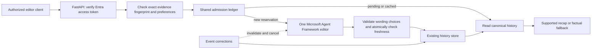

# Authenticated editorial requests

This increment adds the backend controls for an explicit single-editor request.
It is disabled by default locally. The assigned-editor Studio pilot is now enabled
on the hosted app; see [release verification](verification/studio-editorial-live.json). Fan
snapshots, playback, health checks and revision notifications never start a model
call. The factual recap is always available independently of the editor.

## Request path



Cloud storage uses one global control document in the existing Cosmos histories
container, partition `editorial-control-v1`, item `editorial-control`. Conditional
ETag writes serialize quota reservations and duplicate requests across instances.
The history and ledger are deliberately separate transactions: quota is reserved
first, and a crash never refunds it. A final history transaction checks evidence
freshness before accepting wording. SQLite uses `BEGIN IMMEDIATE` in the same file
as local history; container-local SQLite is not a shared cloud quota store.

## Access control

The API validates the RS256 signature against the configured tenant's Microsoft
signing keys, exact v2 issuer, API audience, tenant, expiration and not-before time.
It additionally requires an allowed client application, a valid object ID,
delegated scope `Editorial.Run`, and assigned role `CounterPress.Editor`. ID tokens,
app-only tokens, Graph tokens and unverified proxy identity headers cannot authorize
the paid endpoint. Client IDs, tenant IDs and audience are server configuration;
they never come from unverified token claims. Key retrieval is cached and bounded;
unavailable signing keys fail closed. Error responses omit token/provider details.

The ledger stores a SHA-256 tenant/object identifier for the per-editor allowance,
not a name, email or bearer token. This identifier is pseudonymous, not anonymous.
Only the history service's managed identity should write this control partition;
deleting or restoring the ledger can reset its counters and must be treated as an
operator-controlled budget change.

Authentication follows [Microsoft's claims-validation guidance](https://learn.microsoft.com/en-us/entra/identity-platform/claims-validation)
and uses [PyJWT's signature and claims verification](https://pyjwt.readthedocs.io/en/latest/api.html).
Cosmos writes use [conditional transactional batch operations](https://learn.microsoft.com/en-us/azure/cosmos-db/transactional-batch).

## Durable limits and reuse

The initial policy admits at most **100 requests over the ledger's lifetime**,
**20 per UTC day**, **5 per editor per UTC day**, and **2 concurrent jobs** globally.
These are request allowances, not a dollar billing cap. Each admitted job permits
at most one provider request, 65,536 request bytes and 650 output tokens, with no
SDK retry. A timeout, invalid answer, cancellation or unknown usage is not refunded.
The workflow's provider counter counts transport attempts, including pre-dispatch
admission failures; the ledger's dispatch marker records intent before network I/O.
Neither is a token receipt or proof of a provider charge.
Existing project approval remains US$75 total; this code does not change Azure
budgets or create resources. Any allowance increase requires a reviewed migration;
a runtime policy mismatch fails closed.

The key binds scenario, prompt version, deployment identity and the full factual
fingerprint: source version, score, cutoff, windows and viewing preferences. A
30-second lease prevents duplicate work across replicas/restarts. Dispatch requires
the exact live lease and can be claimed only once. A crashed job may be retried
after its lease expires, consuming another admission. An old owner cannot finish
or dispatch its replacement's job. No database transaction spans a model call.

Completed decisions are reused until the original presentation expires (at most
60 seconds). Aborted work has a 30-second cooldown. Reuse also covers factual
fallbacks; `cached` does not mean an AI adaptation succeeded. Ledger metadata never
substitutes for the canonical, revalidated history. A stale request returns 409
with a factual recap and a fresh fingerprint; it does not silently request new AI.

During work, the controller checks for revisions every 250 ms plus storage latency
and cancels stale tasks. Dispatch checks freshness again. Final publication and
every presentation check the evidence fingerprint independently. Cancellation cannot
undo an already billed provider request. Process termination leaves the durable
reservation and lease for safe recovery.

## API contract

All editorial routes require `Authorization: Bearer <Entra access token>` and return
`Cache-Control: no-store` and `Referrer-Policy: no-referrer`. Never put a token in a
URL, source file, screenshot, shell command history or browser local storage.

1. `POST /api/editorial/{scenario_id}/context` with
   `{"at_ms":780000,"preferences":{"language":"en","depth":"casual"}}`.
   This reads current eligibility, the factual recap and fingerprint; no paid work.
2. After an explicit user action, `POST /api/editorial/{scenario_id}/run` with the
   same fields and the returned `fingerprint`. There is no free-text prompt field.
3. Read `status`, `recap` and optional `workflow`. A supported adaptation has
   `workflow.applied=true`; fallback always retains the factual recap. Context
   changes require a new user decision rather than an automatic paid retry.

| HTTP | Meaning |
| --- | --- |
| 200 | Completed, cached, ineligible or factual fallback; inspect `status`. |
| 202 | This exact context is already pending; `Retry-After: 30`. |
| 401 / 403 | Missing/invalid access token or insufficient editor authorization. |
| 409 | Evidence changed; inspect the updated factual context. |
| 422 | Invalid request, preference or replay position. |
| 429 | Shared quota or concurrency allowance reached; only concurrency includes a retry interval. |
| 503 | Disabled, signing keys unavailable or storage unavailable; no permissive fallback to paid work. |

Public polling remains the existing snapshot API and is free of model calls.
The later [Studio integration](studio.md) supplies Microsoft sign-in, exact-attempt
review and approval/export. Do not paste access tokens into the public demo.

## Activation prerequisites — still pending

Do not enable this in the live app yet. Complete participant review before hosted
activation. The [integration guide](editorial-integration.md) records the configured
single-tenant Entra API and successful real local sign-in. Use v2 access tokens,
delegated scope `Editorial.Run` and user role `CounterPress.Editor`. Use a separate
approved client registration for the eventual sign-in flow; grant the scope and
assign the editor role only to intended reviewers. Verify real allowed and denied
tokens on the eventual hosted route before activation.

For a controlled local integration session, private environment configuration is:

```text
COUNTERPRESS_EDITORIAL=entra
COUNTERPRESS_ENTRA_TENANT_ID=<tenant UUID>
COUNTERPRESS_ENTRA_AUDIENCE=<API application client UUID>
COUNTERPRESS_ENTRA_CLIENT_IDS=<allowed client UUIDs, comma separated>
```

The existing private Azure OpenAI variables must also be supplied. Use a persistent
SQLite file locally; hosted activation must use the existing Cosmos mode and
managed identity. Start locally:

```sh
uv run --env-file .env --frozen uvicorn counterpress.api.main:app --reload
```

The application
will reject incomplete auth/model configuration or in-memory admission storage.

The [live integration record](verification/editorial-integration.json) now verifies
Cosmos conflict/fresh-process behavior under the existing managed identity and
real Entra authorization against the local API. Before cloud activation, verify
hosted-route authorization, current Azure usage, live model behavior through
the authenticated route, and cancellation on real revision delivery. Deploy the
expanded audit schema before single-editor writes. Keep secrets in private Azure
runtime configuration. Turning `COUNTERPRESS_EDITORIAL=off` blocks new requests;
already accepted wording can remain visible until its original expiry, at most
60 seconds, or an evidence revision invalidates it sooner.

## Verification scope

`tests/test_editorial_controls.py` exercises signed tokens and authorization errors,
SQLite concurrency, Cosmos ETag conflicts with a transactional service double,
restart/reuse, quota exhaustion, expired leases, storage failure before dispatch,
corrections during work, cancellation, expiry, preferences and API behavior. It
uses mocked model responses and generated test signing keys; it spends no Azure
credits. These unit tests are distinct from the later real integration record
above; neither is a human usability result.

The original paid pilot and `fixtures/evaluation/editorial_lock.json` remain
unchanged. The current offline/mocked regression suite uses a separately versioned
`editorial_controls_lock.json`; it is not a rerun or extension of that paid pilot.
