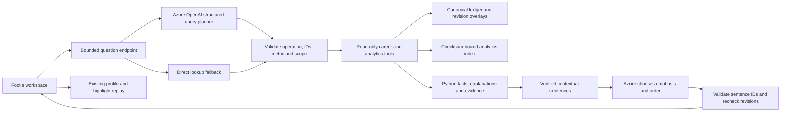

# Footie grounded football assistant

Choose **Footie** in the hosted dashboard, or use `#assistant` in a local preview. See the [README startup commands](../README.md#quick-start) for a configured local instance.

You can also choose **Ask Footie** on a Clubhouse player/club profile, a linked
Matchday highlight, a Match Centre play, the full-match replay, or a career
highlight opened from Clubhouse. A dialog keeps the source page in place.
Profiles carry their selected season and library date. Replays pause and capture
the current source event, revision and availability cutoff. The context stays
fixed inside the dialog; close it to resume or choose another moment.

Opening the panel prefills a question but never submits it. Press **Send** or a
suggested question to invoke the assistant. **Escape** or the close button returns
focus to the source button, with the replay still paused. Preloaded standalone
reconstructions have no career-match handoff; their events are not added to career
statistics. [Context integration verification](verification/footie-context.md).

## Try it

- “How prolific has Mateo Cross been over his career?”
- “Who has supplied the most assists for Redhaven?”
- “Put Rory Ellis and Dario Voss side by side on goals per 90.”
- “Is Enzo Clarke's recent assist rate higher than across his career?”
- “Compare Mateo Cross's goals in 2025-26 and 2026-27.”
- Open **A match**, choose **Southbank × Redhaven · 2026-10-19**, then choose
  **Explain the latest goal**. Footie explains the 2–2 to 2–3 lead change and
  Mateo's 75th career goal. **Watch the goal** opens the existing pitch replay.

A follow-up such as “And last season?” reuses the preceding query's subject and
metric. Changing the player, club, season or match starts a new scope and clears
the conversation. Favorite players are marked in the picker; a sole favorite is
selected on entry. Explicit “my favorite player” resolves only when there is one;
“my club” uses the saved primary club. Other ambiguous choices require clarification.

**Check the numbers** expands the subject, metric, scope and covered appearances.
Charts compare one measure at a time. Player lookups also show recorded action
locations; these maps are not continuous tracking. Missing observations are
shown as unavailable. Conversations remain in React memory and disappear on
refresh; existing favorites continue to use device storage.

## Architecture



The existing Microsoft Azure OpenAI deployment interprets a question into a
strict query plan. The adapter uses Azure's documented
[structured outputs](https://learn.microsoft.com/en-us/azure/ai-services/openai/how-to/structured-outputs).
The model selects an approved operation and its arguments. It never writes SQL,
executes code, chooses arbitrary URLs, supplies statistics or generates the
answer prose. Python calculates the facts and contextual sentences from the
selected records. A second, smaller Azure request chooses the most useful lead
and supporting sentences. This is constrained narrative composition, not
unrestricted generated prose or general football chat. No new Azure service or
vector database is required.

The story can explain per-appearance scoring/assist/save/shot rates, the numerical
gap between comparable players or periods, ties, score changes and career
milestones. Each sentence binds its exact source fact indices and an evidence
fingerprint. Names, numbers, units and periods are never interpolated from model
output. Comparisons require complete coverage of the same metric/unit; total
comparisons retain the appearance denominators. Per-appearance rates are not
probabilities of scoring and do not replace per-90 measures.

The model returns only approved sentence IDs. Invalid IDs, extra prose, repetition,
timeouts or exhausted quotas retain a calculated story. After the model responds,
the service rechecks the records under the revision lock and replaces stale
sentences if a correction arrived. Casual mode selects up to two sentences;
analyst mode up to three. The new narrative layer is English-only for now; Chinese
keeps the existing localized factual answer. The interface leads with the story
and retains original statements under **Figures and context**.

Operations are player metric lookup, two-to-four-player comparison, last-five
form, two-season comparison, club contributors, selected club totals and
match/milestone explanation. Player measures use the existing 71-definition
catalogue with role and coverage restrictions. Club totals support canonical
career counts and pass completion; unsupported club-derived measures remain
unavailable. Per-90 player comparisons need at least 180 covered minutes. A
ranking is for the selected club and recorded period, not a global player rating.

`POST /api/fan/assistant/ask` accepts a bounded question, preferences, selected
subject/season/date, optional match and `cutoff`, and an optional previous plan.
Embedded moments additionally send `event_id` and `event_revision`. The pair
requires an explicit match and cutoff. A selected pass/shot/challenge is explained
directly; an unresolved or unavailable revision cannot disclose its outcome.
For older rebased highlights, `GET /api/fan/assistant/moment` resolves the selected
source reference to canonical timing without exposing an outcome or calling AI.
Only the previous structured intent is sent back; prior answer text is never
trusted as data. `GET /api/fan/assistant/config` describes local availability
without exposing a model endpoint, deployment name or credentials.

## Grounding and temporal rules

- Facts bind subject ID, metric, unit, period, value, coverage and evidence.
  Answer fingerprints include the full plan and facts. Evidence carries canonical
  match digests and, for goals, event IDs/revisions and the career baseline.
- Explicit known names and explicit metrics are checked against the plan. Unknown
  IDs, unsupported operations or invalid scopes cannot become tool calls.
  This is not proof of perfect semantic interpretation; the question evaluation
  below remains necessary, and a user can inspect the resulting scope.
- Compound data reads run under the existing revision lock; network calls never
  hold that lock. Revisions bypass affected cached reductions. A retracted goal
  changes totals and removes a stale milestone/replay action on the next request.
- The library cutoff defaults to the day after its most recent featured match,
  matching Clubhouse. Career reads include completed appearances only. Recent
  form uses up to five completed appearances from that same selected period.
- Match questions require an explicit playback cutoff. Only available event
  revisions at that cutoff can affect score, explanation or milestones. A clip
  is offered only after its final event is available and its source is unchanged.
  The separate workspace starts match questions at full time; embedded dialogs
  freeze the displayed action's source cutoff. API tests exercise the instant
  before/after a goal, stale revisions and retracted moments.
- Career queries with an active playback cutoff require a scope change rather
  than silently leaking final career values into a replay. As-of dates also bound
  allowed playback time.
- Preferences can affect selection and presentation, never underlying facts.
  English and Chinese preferences retain the same evidence; metric labels and
  the first interface remain primarily English.

## Local startup and controls

```sh
npm --prefix frontend run build
.venv/bin/python scripts/run_footie_local.py --azure
```

The optional `--azure` flag reads only the existing three Azure OpenAI settings
from the ignored local `.env`. Values stay server-side and are never included in
the UI or request logs. There is no need to put keys in chat. Without `--azure`,
the same page supports direct statistics lookups and the suggested questions.

The launcher binds to `127.0.0.1`, disables Azure event streaming, uses local SQLite
history at `var/footie-local.sqlite3`, and uses an in-memory career index. Existing
local databases are retained. Hosted defaults do not enable the planner.

Each question makes **at most two model requests**, with no retries or redirects:
the planner allows 500 completion tokens, an eight-second network timeout and a
ten-second total deadline; narrative selection allows 180 completion tokens, a
five-second network timeout and a six-second total deadline. Both use bounded
response bodies and share a two-call concurrency gate.
The local process allows **20 total model attempts per rolling hour across both
stages**, plus 30 HTTP questions per minute. Direct lookup/calculated stories
remain available within the HTTP limit. These
are process-local allowances, not a monetary billing cap or a distributed
production quota. Restarting resets them. Public deployment needs authenticated
access and shared quotas before enabling paid inference.

Structured operational logs record random request ID, operation, duration, mode,
usage for each stage and fallback category. They exclude questions, answer bodies, credentials
and endpoints. A timeout may be billed without returning token usage. Full billing
must be checked in Azure; returned token counts are not a complete cost statement.

## Validation and current limits

See [the verification record](verification/grounded-assistant.md) for exact commands,
results, browser checks and the original eight bounded live Azure attempts.
The newer narrative checks are recorded in
[narrative verification](verification/footie-narration.md).

No career statistics, identities, portraits or existing match archives were
regenerated in this stage. No Git push, hosted deployment, ingestion bridge or
new Azure resource was created. The assistant reads the local canonical career
store and its revision overlays; it is not yet connected to live career-index
updates from Event Hubs. It cannot analyze newly uploaded footage, infer injuries
or tactics from unseen video, predict results, or invent tracking measurements.
It does not have open-web research tools or an unrestricted language-model answer
path. Safe lookup fallback is explicit when interpretation is unavailable.

Next: review the profile and moment handoffs as a fan before publishing them.
The assistant remains bounded to the supported statistical and event questions;
it cannot infer tactical causes from unobserved tracking.

## Footie mascot

The approved cream-and-green football character is recreated as a lightweight
inline SVG in `frontend/src/assistant/FootieMascot.tsx`, with independent eyes,
flippers and feet. It greets visitors, follows the desktop pointer within a small
range, listens when the question field is focused, and thinks while a request is
pending. Answers use a small avatar; an answer with a goal replay gets a brief
celebration. Resting artwork is available but is not triggered automatically.
Greeting and celebration settle after 2.4 seconds. No extra network calls are used.

The current design has simple studded boots and a small crooked smile; the cap,
pink cheeks and elongated eyes have been removed.
Change `--footie-ink`, `--footie-body` and `--footie-shade` in
`frontend/src/assistant/mascot.css` to recolour it. This is an animated vector
adaptation of the approved concept, rather than a crop of the presentation sheet.
The SVG is decorative; readable request status remains outside it. Reduced-motion
preferences disable animation and cursor tracking, and touch pointers do not
control its gaze.

Validated locally: `npm --prefix frontend test` (166 tests passed) and
`npm --prefix frontend run build` (passed). Browser verification:

```sh
NODE_PATH=/Users/haydn/.cache/codex-runtimes/codex-primary-runtime/dependencies/node/node_modules node scripts/test_footie_mascot.cjs
```

```text
PASS Footie mascot: cursor gaze, typing/listening, pending/thinking, answer avatar, reset, reduced motion, 390/360px layout; no browser errors or model calls.
```

The browser check intercepts the assistant answer; it does not invoke Azure.
Screenshots are saved under `var/footie-mascot-*.png`. The integration is local;
it has not been pushed or deployed.

## Historical validation — 21 October 2026

The assistant and contextual dialogs described above were published in the
20 October release; the earlier local-only statements are historical. The new
[58-question benchmark](verification/footie-question-benchmark.md) and its fixes
are not yet published. Metric phrases now distinguish chance creation, assists,
expected assists and specific goalkeeper/passing measures. Follow-ups preserve
scope, and the server rejects a model plan that silently changes a career question
to the current season. All 58 offline cases pass. The initial live sample and
subsequent targeted checks are retained separately; they do not establish broad
model accuracy. The live career-index bridge remains next.

### Shared career corrections

With the opt-in [career revision bridge](career-revision-bridge.md), every compound
answer reads a refreshed durable career snapshot. The post-narration check also
refreshes it, catching corrections committed by another instance. Browser revision
signals clear stale conversation answers and abort pending replies without making
a replacement model request. Source-sequence/time cutoffs still apply; receiving
a correction does not expose it in playback before its availability time.
