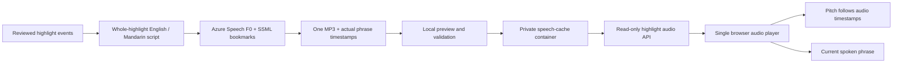

# Highlight commentary

## Current approach: one complete recording per highlight

The previous event queue lagged behind the pitch. Replacing it with individual
surname calls solved timestamp drift but damaged the commentary. Neither a
sentence queue nor isolated name announcements is used by the current Matchday
voice path.

Each of the six recorded highlights now has a reviewed, coherent English and
Mandarin script. Azure synthesizes the whole script in one request. Bookmarks
inside the SSML return the actual time of each phrase. The browser plays one
uncut MP3 and maps its `currentTime` to the illustrated pitch's playhead. Goal and
save reactions use bookmarks at the shot's visible resolution point.

Example: “Mercer drives forward, then releases Hart into space. Hart carries it
towards the box and sends the cross over. Vale heads it back for Ellis—Ellis hits
it! Goal! A stunning counterattack!”

This is a narrated replay, so its duration can differ from silent playback.
Sentences finish naturally; no phrase is dropped to meet a fixed event slot.
HTML media playback preserves pitch when the user changes speed. Pause/seek/replay
use the same recording and timestamp map. Natural completion waits for the actual
media `ended` event, including the last words and breath. Matching phrase captions
appear in Live Companion. Reduced motion uses discrete pitch states.

**Matchday remains highlights-only.** Full-match replay is in Match Centre and has
text/statistics/questions, without narration. Guided answers remain based on the
completed, available event prefix. Narration is prepared for recorded highlights;
this is not a new live match ingestion or free-form commentary agent.

## Authoring and serving



`backend/counterpress/live/highlight_narrative.py` holds the reviewed scripts and
source fingerprints. Changed events fail closed until their script is reviewed.
Asset keys hash both the source and complete SSML. Each atomic JSON bundle
contains audio and its exact matching bookmarks, avoiding stale timing files.

Authoring uses `scripts/prepare_highlight_commentary.py`. Install the local-only
Speech SDK with `uv pip install --python .venv/bin/python
azure-cognitiveservices-speech==1.52.0`. Configure the existing private Speech/Blob
settings, then run `.venv/bin/python scripts/prepare_highlight_commentary.py`.
Outputs and listenable MP3s go to ignored `var/commentary/`. Review them, then use
`--publish` to upload validated bundles to `narration/v2/` in the existing private
cache. `--story` and `--language` support targeted regeneration.

The SDK is authoring-only; it adds no native Speech dependency to the app image.
Production `/api/voice/highlight` only serves prepared bundles. It validates the
complete highlight IDs/revisions and language, rejects caller text/SSML and full
matches, and never triggers synthesis. Missing assets leave silent playback and
text available. `COUNTERPRESS_COMMENTARY_DIR` is an optional local preview path;
production reads the private cache using its existing managed identity.

## Cost and privacy

Existing Speech **F0**, private Blob storage and managed identity are reused.
Authoring reserves characters through the existing durable **200,000 weighted
characters/month** quota, and serial syntheses are spaced by at least five
seconds. Failed provider attempts remain reserved. There is no paid-tier upgrade.
Repeated viewing/replay does not synthesize or consume speech characters. Blob
storage/transaction charges still apply. Provider endpoints and credentials never
reach the browser or repository. Generated audio remains outside Git.

## Verification

```sh
.venv/bin/pytest -q
npm --prefix frontend test -- --run
npm --prefix frontend run build
node scripts/test_highlight_sync.cjs http://127.0.0.1:8014
node scripts/test_highlight_controls.cjs http://127.0.0.1:8014
```

Run audio browser checks sequentially: competing players can take operating-system
audio focus. The app reflects an external audio pause in its replay controls.

The real-audio browser check covers all six highlights and both languages, complete
phrase coverage, exactly one audio start, natural completion without cuts,
bookmark-to-pitch alignment, first-voice latency and preserved pitch at speed
variants. Controls cover pause/resume, seek, restart, mobile layouts, reduced
motion, preparation failure and no full-match narration. Unit/API checks cover
inverse seek mapping, whole scripts, source changes, asset validation and
cache-only serving. These checks establish behavior; they do not replace human
judgment of whether the voice sounds engaging.

References: [Azure SSML bookmarks](https://learn.microsoft.com/en-us/azure/ai-services/speech-service/speech-synthesis-markup-structure),
[Microsoft Entra authentication](https://learn.microsoft.com/en-us/azure/ai-services/speech-service/how-to-configure-azure-ad-auth).
