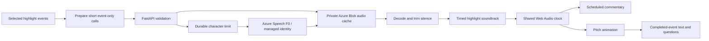

# Live Companion

## Current experience — 19 October 2026

**Matchday contains highlights only.** Open a highlight, choose **Listen**, wait
for **Commentary ready**, then **Play highlight**. The first play prepares the
selected language's Azure audio; subsequent replays reuse decoded audio. There
are no speech requests during playback. Full matches remain in **Match Centre →
Match library**, with text, statistics and guided questions, but no narration.

English uses `en-US-GuyNeural` (`newscast` / `excited`); Mandarin uses
`zh-CN-YunjianNeural` (`sports-commentary` / `sports-commentary-excited`). These
are short football calls: player surnames during the build-up and a reaction at
the visible shot result. Location detail remains available in text. Silence is
preferable to a late description of an earlier action.

## Why the queue was replaced

The original sentence-completion queue prevented interruptions but fetched audio
only after an action completed. Network/synthesis latency delayed the opening
call, and long sentences fell behind the pitch. A bounded queue still cannot
synchronize two independent clocks. It is no longer used for highlight playback.

The replacement prepares/decode-checks the whole highlight before enabling voiced
playback, trims provider padding, and schedules short clips on Web Audio's clock.
The animation reads that same clock. Routine calls that cannot fit are omitted;
shot reactions take priority. Reactions start at the shot's 60% resolution point,
when the ball arrives and the result becomes visible. Shot segments can grow just
enough to fit the short reaction without cutting it off. Opening and shot actor
calls have reserved space. Source event timestamps are unchanged.

Pause, seek, speed changes, highlight/language/revision changes, backgrounding and
unmount stop scheduled audio. Resuming schedules the remaining audio at the
current offset. Speed changes apply to both audio and animation; Web Audio rate
changes also alter pitch, so 1× is recommended for the natural broadcast voice.
Reduced-motion viewers can hear commentary while the pitch changes between
static action states. If preparation fails, playback remains available silently
with text and a retry action. There is no delayed device-voice fallback.



## Evidence and API boundaries

The speech endpoint accepts only known match/event IDs and revisions, language,
a cutoff and a fixed delivery mode. `highlight-action` and `highlight-result`
require a single showcase event; results require a shot. It accepts no caller
text, SSML, voice name or endpoint. Preparation can access the selected recorded
highlight, but outcome audio is not played until its visual resolution point.
Text answers continue to use only the available completed event prefix.

The full-match API and playback remain available for the native generated match.
This is historical replay, not new live Event Hubs ingestion. Questions are guided
and event-grounded, not free-form model conversation. Illustrative player movement
is not used as tracking evidence or a claim of complete audio description.

## Cost and configuration

- Existing Azure Speech **F0**; no automatic paid-tier upgrade.
- At most 15 new syntheses/minute per app replica. Cached clips do not synthesize.
- Private Blob counter reserves at most 200,000 conservatively weighted characters
  per UTC month, using ETags. Failed provider attempts are not refunded.
- Cache keys hash the complete SSML. Audio is not committed to Git. Blob storage
  and transactions retain their normal small charges under the project budget.
- Managed identity keeps credentials and provider endpoints server-side.

Server settings: `COUNTERPRESS_SPEECH=azure`, `COUNTERPRESS_SPEECH_TIER=F0`, and
private `COUNTERPRESS_SPEECH_ENDPOINT`. Reuses `COUNTERPRESS_STREAM_CLIENT_ID` and
`COUNTERPRESS_CHECKPOINT_ENDPOINT`. Identity needs **Cognitive Services Speech
User** on the Speech resource and **Storage Blob Data Contributor** on the private
`speech-cache` container. Local verification may use
`COUNTERPRESS_SPEECH_AUTH=azure-cli`. Disabling Speech leaves text and silent
playback available. Existing Azure deployment preserves configuration/secrets.

## Verification

```sh
.venv/bin/pytest -q
npm --prefix frontend test -- --run
npm --prefix frontend run build
node scripts/test_highlight_sync.cjs http://127.0.0.1:8012
node scripts/test_live_companion.cjs http://127.0.0.1:8012
node scripts/test_full_match.cjs http://127.0.0.1:8012
```

Browser scripts require Playwright/Chrome. The sync script uses **actual Azure
MP3s and actual Web Audio**, all six highlights and both languages. It checks
first voice onset, reaction timing against the pitch, speed variants and zero
speech fetches during playback. It consumes the configured, budgeted Speech
service on cache misses. Unit tests cover the shared clock, offsets, scheduled
node cancellation, silence trimming, timeline gaps and no overlapping calls.

Next: football-fan listening feedback at 1×, particularly Mandarin pronunciation,
and accessibility usability testing before claiming accessibility outcomes.
