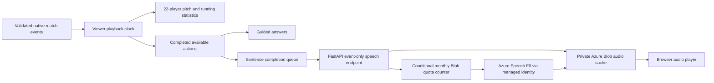

# Live Companion

The first implementation lives inside Matchday, immediately below its animated
pitch. Open a highlight, choose **Listen**, then play. **Follow the play** opens
location detail, three questions and the last three completed actions. The
existing English/Chinese preference applies throughout.

This is the first migration away from producer script preparation toward an
optional companion for viewers. Studio remains available under Tools; this change
does not alter its saved work or approval controls.

## Initial release — 18 October

- Optional device speech, off by default, synchronized to the pitch playhead.
- Completed-action commentary with optional location descriptions.
- Questions about the latest completed action, recent build-up and sequence totals.
- Expandable source actions behind each answer, without JSON in the viewer UI.
- Pause, seek, revision and language invalidation; a bounded speech summary buffer.
- Text remains usable if speech is unsupported or fails. Backgrounding the page
  stops speech. A natural finish can complete its final spoken cue.

The evidence selector gates both presentation order and revision availability.
It chooses the highest available revision for each event in the current match.
Answers and displayed evidence are discarded on playhead or source changes.
Counts refer to the displayed sequence so far, never full-match totals. Build-up
uses at most four completed actions within 30 seconds, stopping at a recovery or
half boundary. It describes recorded actions, not inferred tactical causes.

## Initial architecture and scope

Existing snapshot API → MatchPitch playhead → completed-event selector →
deterministic answers and text → optional browser SpeechSynthesis.

No new API, model calls, credentials, Azure service or recurring charge is added.
Azure Speech configuration was not present in the local configuration check.
Device speech is not Azure Speech; voices and pronunciation depend on the browser
and installed voices. Text is derived from event records, not a transcript of an
original broadcaster. This is not complete video audio description, and the
illustrative off-ball positions are not used as analytical evidence.

The initial release covered Matchday highlight/sequence playback. It does not yet
provide a full-match paced stream, free-form conversational AI, microphone input,
translation of broadcast audio, or broadcast overlays. These are subsequent
integration work, not hidden capabilities of the question buttons.

## Original integration roadmap

1. Run the synthetic full-match feed through a viewer-specific clock, preserving
   pause/seek and source revision availability; compute scores and statistics
   only from that clock's available event prefix.
2. Add Azure Speech behind server-side configuration and a bounded cache, retaining
   the text experience and device fallback. Review cost against the $75 total
   project allowance before enabling paid usage.
3. Add authenticated, rate-limited free-form questions using the existing model,
   with evidence selection at the viewer clock and cancellation on seek/revision.
   Keep immediate action commentary deterministic so model latency cannot delay goals.
4. Test comprehension and controls with football viewers, including blind/low-vision
   and deaf/hard-of-hearing participants, before claiming accessibility outcomes.

## Verification

Run `npm --prefix frontend test -- --run` and `npm --prefix frontend run build`.
Regression tests cover future-outcome exclusion, source availability, revisions,
match isolation, build-up boundaries, answer invalidation, opt-in speech,
cancellation, natural endings and speech failure. Browser verification:
`node scripts/test_live_companion.cjs http://127.0.0.1:8010` (Playwright required).

## 19 October 2026 — speech pacing correction

The original implementation cancelled speech on every pending/resolved playhead
transition. Fast highlights therefore repeatedly interrupted sentences. Commentary
now waits for the browser utterance's `end` event before starting the next update.
Pending setups update text only. While a sentence plays, up to four completed
actions are retained: consecutive completed passes by the same side become a
short passing summary; otherwise the latest action is used. A pending shot takes
priority over routine actions at the next sentence boundary. This deliberately
omits routine actions when playback outpaces speech instead of building a backlog.

Pause, explicit seeking (including seeking to the end), mute, source corrections,
language/detail changes and leaving the page invalidate both current and queued
speech. Natural playback completion drains the bounded summary. Generation checks
ignore callbacks from cancelled utterances. No fixed speech-duration estimate or
forced increase in voice speed is used by the scheduler.

Reference: [browser speech completion event](https://developer.mozilla.org/en-US/docs/Web/API/SpeechSynthesisUtterance/end_event).

`node scripts/test_companion_speech.cjs http://127.0.0.1:8010` runs three real
highlight animations at 1.5× with an instrumented four-second voice. It checks
sentence completion, zero routine interruptions, a completed goal announcement
and a drained queue. This tests scheduling, not audible device voice quality.

## 19 October 2026 — full match and Azure broadcast voices

Open **Match library → Watch the full match**, or the full-match link on Matchday.
The new `#live` surface plays the 18 October Eastbridge–Northport generated match
at 1×, 1.5× or 3×. It has 22-player pitch playback, pause/seek, a halftime stop,
running score and shot/completed-pass totals. Scores and answers use the available,
completed event prefix; the raw match archive is still readable through the API.
The source occurrence and availability times both gate presentation. The second
half resumes from 45:00; full time is 90:00. Historical feed download does not
represent a new live Event Hubs ingestion stream.

**Listen** now defaults to the Azure broadcast voice when configured. English uses
`en-US-GuyNeural` with `newscast` for build-up and `excited` for shots. Mandarin uses
`zh-CN-YunjianNeural` with sports commentary styles. All speech is based on recorded
completed actions, with optional location context. The existing queue still waits
for audio completion, compresses rapid arrivals and cancels on seek. Device voice
is selectable and is the fallback for timeout, quota or playback failures.

The speech API accepts a match ID, at most four consecutive event IDs/revisions,
a playback cutoff, language and detail preference. It rejects arbitrary text,
SSML, unsupported languages, unknown records and unavailable/revised records.
It never returns provider endpoints, credentials or raw Azure exceptions.

Costs and limits:

- Speech resource remains **F0**, with no automatic paid-tier upgrade.
- At most 15 new syntheses/minute per single app replica; cached responses bypass
  synthesis. Azure also enforces its own F0 service limits.
- A private Blob counter reserves at most 200,000 conservatively weighted text
  characters per UTC month, using conditional ETag writes. Attempts remain charged
  to the allowance even on provider failure; deployments do not reset it.
- Private cache keys hash the full SSML, including voice/style. No audio is checked
  into the repository. Existing Blob storage incurs normal small transaction and
  storage charges within the existing project budget.
- Azure configuration uses managed identity, not exported speech API keys.

Server settings are `COUNTERPRESS_SPEECH=azure`, `COUNTERPRESS_SPEECH_TIER=F0` and
`COUNTERPRESS_SPEECH_ENDPOINT` (private custom-domain HTTPS origin). The adapter
reuses `COUNTERPRESS_STREAM_CLIENT_ID` and `COUNTERPRESS_CHECKPOINT_ENDPOINT` for
identity and the private `speech-cache` container. Grant **Cognitive Services
Speech User** only on the speech resource and **Storage Blob Data Contributor**
only on that container. Local verification can explicitly set
`COUNTERPRESS_SPEECH_AUTH=azure-cli`. Runtime speech defaults to off. Disable with
`COUNTERPRESS_SPEECH=off`; device speech continues to work. The deployment workflow
preserves these settings, existing secrets, scaling and other services.

Verification: 619 backend tests; 137 frontend tests; production build; full-match
browser checks for scores/rewind/halftime/restart, English/Mandarin and 360/390/760px;
actual Azure-generated MP3s decoded and played to completion in Chrome (English
4.68s, Mandarin 3.53s). `scripts/test_broadcast_voice.cjs` intentionally requests
real speech and should only run against a configured, budgeted environment.

References: [supported voices/styles](https://learn.microsoft.com/en-us/azure/ai-services/speech-service/language-support),
[REST synthesis](https://learn.microsoft.com/en-us/azure/ai-services/speech-service/rest-text-to-speech),
[quotas](https://learn.microsoft.com/en-us/azure/ai-services/speech-service/speech-services-quotas-and-limits),
[pricing](https://azure.microsoft.com/en-us/pricing/details/speech/).

Free-form AI questions, microphone input and coverage for the two provider-derived
archived matches remain separate work. This release extends the guided companion
to the native generated full match and adds Azure speech to existing highlights.
