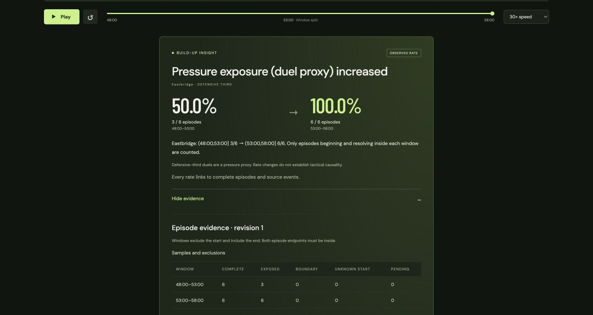
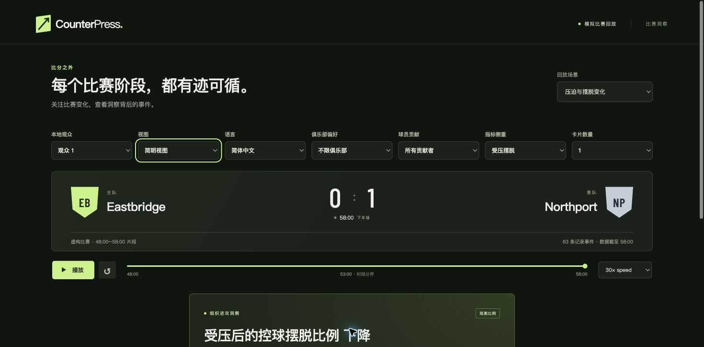

# Pressure publication and replay cards — Stage 8, third increment

Pressure exposure and defensive build-up escape now have durable, independent
insight histories and browser cards. The existing recovery insight remains
available. All three metrics compete for the viewer's zero-or-one card budget;
preferences affect selection and wording, never the underlying evidence.

## Try the interface

Start the API and frontend using the [README](../README.md). Select **Pressure
and escape shift**, then **Go to comparison**. The default card shows exposure
increasing from 3/6 (50%) to 6/6 (100%). Choose **Escape under pressure** under
Metric focus to see 3/3 (100%) to 1/6 (16.7%). Switch between analyst/casual and
English/Simplified Chinese; fractions and source revisions remain unchanged.

**Show evidence** presents sample sizes, boundary exclusions, unknown starts and
pending counts. Expand an episode to inspect its classification in each window,
pressure-proxy references and exact source JSON. Analysts can also inspect
publication identity, rule version and availability. The pressure card uses
episode evidence rather than the recovery-only pitch markers.

Player selection highlights recorded involvement by that player on the subject
team. It does not attribute an episode outcome or tactical credit to them.
`eb04` has source involvement; `eb08` has none in these controls. Team rates and
the full denominator evidence remain visible and unchanged. A zero card budget
hides all stories. **Pressure and escape control** has actual exposed episodes
and escapes but no eligible rate change.

The browser scenarios stretch the hand-authored two-minute control event times
by a factor of five around 48:00, giving the existing 48:00–53:00 and 53:00–58:00
windows. Their positions, actors, order and outcomes are unchanged. Match IDs
gain `-replay` to distinguish them from the CLI controls. These are deliberate
demonstration timelines, not newly calibrated simulation outputs. The raw
two-minute fixtures and independent expectations remain untouched.

## Corrections and historical replay

Using the same database as the API, run:

```sh
UV_CACHE_DIR=.uv-cache uv run --frozen python -m counterpress.ingest pressure-increase fixtures/pressure/replay_corrections.json
```

The UI discovers the longer horizon while paused; it does not move the viewer.
Seek explicitly to inspect each state:

| Availability | Correction | Exposure story | Escape story |
| --- | --- | --- | --- |
| 58:00 | Original evidence | Create r1: 3/6 → 6/6 | Create r1: 3/3 → 1/6 |
| 58:05 | `b3-duel` becomes a stationary carry | Update r2: 2/6 → 6/6 | Withdraw r2: baseline exposed sample is only 2 |
| 58:10 | `c1-duel`–`c4-duel` become stationary carries | Withdraw r3: 2/6 → 2/6 | Remains withdrawn |
| 58:15 | Restore all five source duels as revision 3 | Create r4: 3/6 → 6/6 | Create r3: 3/3 → 1/6 |

The comparison identity remains stable through withdrawal and recreation. Each
change invalidates its own immediately preceding evidence revision. Retrying
the ingestion is idempotent. Seeking back to 58:00 reproduces both original
publications, including original source revisions. An invalid source batch rolls
back both source and publication writes.

## Persistence and API

SQLite now has additive `pressure_changes` and `pressure_checkpoints` tables.
Publication keys are `(scenario, insight_id, revision)`; an ordinal preserves
delivery order. Existing recovery, adaptation and workflow tables are unchanged.
`History.pressure_changes` defaults to empty for older histories. On first use,
older databases rebuild pressure publications at their original observation
cutoffs and record a source-count checkpoint. Existing source and recovery
history is not rewritten, and repeated reads do not repeat the migration.

Insight/evidence IDs derive from match, subject team, metric, rule version and
window pair. Source revisions and fractions determine updates; a cutoff-only
advance does not create a revision. Published non-withdrawal histories supply
cooldown receipts to the detector. Current replay scenarios use one fixed window
pair, so source corrections correctly bypass the different-comparison cooldown.

Snapshot responses add:

- `pressure_lifecycle`: the latest publication per pressure insight available at
  the requested cutoff, including withdrawal tombstones.
- `pressure`: the highest-ranked eligible pressure presentation for the supplied
  preferences, or a collecting/empty/budget state.
- `selected_kind`: `recovery`, `pressure` or null; the single card chosen from the
  combined eligible candidate pool.

The original `insight`, `evidence`, `audience` and `comparison_status` fields retain
their recovery-specific meanings for compatibility. Clients use `selected_kind`
to decide which card to render. A candidate in either stream is not automatically
an additional displayed card.

Retrieve a frozen publication, including withdrawn evidence, through:

```text
GET /api/scenarios/{scenario}/pressure/{insight_id}/evidence/{revision}?at_ms={cutoff}
```

The endpoint checks scenario, insight identity, revision and availability cutoff,
returns 404 when unavailable, and sends `Cache-Control: no-store`. Multiple
stories may legitimately each have revision 1, so the insight ID is required.

The browser validates pressure wording identity/revision and viewer preferences.
It also retains an independent revision watermark for every pressure stream,
including tombstones. Missing or older streams cannot replace newer evidence
within a forward playback scope. Intentional seeks, viewer changes and preference
changes create fresh scopes and can display historically valid revisions.

## Audience ranking and wording

Candidates start at priority 10, gain 20 for the preferred subject club and 30
for a selected player with recorded involvement. A matching metric focus adds
10; a nonmatching non-balanced focus subtracts 5. Recovery wins an equal-priority
cross-metric tie for continuity; pressure ties use metric and stable insight ID.
Club preference is a ranking preference, not a hard filter. `passing` does not
create a passing story.

Pressure narratives use deterministic bilingual templates freshly rendered from
the selected publication. They have no model requests or separate narrative
cache; corrections immediately select the new publication and wording. Existing
recovery variants retain their bounded revision-aware cache. The Azure Analyst/
Producer workflow still targets recovery stories only.

## Verification and remaining scope

All 284 backend tests and 20 frontend tests pass; the frontend production build
passes. The 11 new backend tests cover reviewed fractions, independent revision
streams, withdrawal/recreation, restart recovery without fixture files, legacy
backfill, atomic rejection, cutoff-scoped evidence lookup, bilingual/player views,
viewer isolation and shared card ranking. Four new frontend tests cover episode
inspection, translated rates, pressure tombstones, stale/missing streams,
withdrawal/recreation in the screen and mismatched API narratives. Exact command
output is in [progress](archive/development-history.md).

Chrome review confirmed the English exposure card, episode sample table, Chinese
casual escape view, correction horizon discovery, 58:10 withdrawal, 58:15
restoration and the negative control's empty state. Review used a separate ignored
SQLite database, not the user's normal replay database. Temporary servers and
the review tab were closed afterward.




Pressure remains a disclosed duel proxy, and changes are descriptive rather than
causal. The new screen uses the reviewed scenarios; procedural feeds remain
available through the CLI. [Possession without progression](progression.md) now
adds its own positive/negative controls, eligibility, cooldown and lifecycle tests.
Next: player-contribution detection with independent attribution controls. Recaps,
broader model adaptation and Azure application deployment remain later work.
