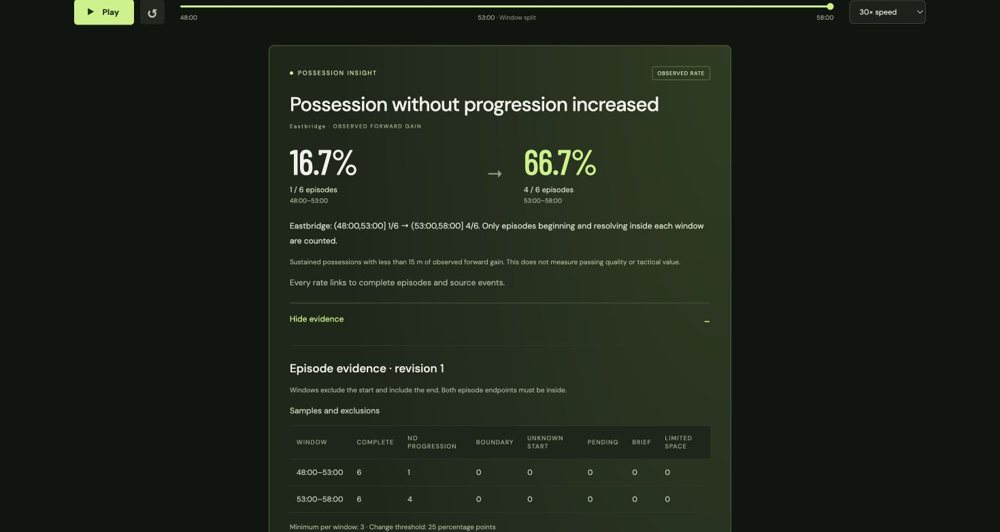

# Possession without progression — Stage 8, fourth increment

The `possession_without_progression` metric compares the fraction of sustained,
resolved possessions that fail to reach 15 metres beyond their starting x position.
It uses observed control in the normalized attacking direction on the 105 × 68 m
pitch. It is a spatial proxy, not possession dominance, passing quality or tactical
value. A team can advance and return to its starting area without qualifying as
“without progression.”

## Try it locally

```sh
UV_CACHE_DIR=.uv-cache uv run --frozen python -m counterpress.progression fixtures/progression/increase.json
UV_CACHE_DIR=.uv-cache uv run --frozen python -m counterpress.progression fixtures/progression/control.json
```

Default windows are `(48:00,53:00]` and `(53:00,58:00]`. Add `--json` for typed
evidence, `--at 58:10` for an availability cutoff, `--updates PATH` for source
revision records, or `--publications PATH` for cooldown receipts. `--team` and
`--windows START SPLIT END` choose the subject and comparison.

Start the API and frontend using the [README](../README.md). Select **Possession
without progression**, then **Go to comparison**. The card shows 1/6 (16.7%) to
4/6 (66.7%). **Progression control** has no eligible change. **Show evidence**
discloses each denominator and exclusion category; expanding an episode shows
maximum forward gain, completed actions, observed span and exact source revisions.
English/Simplified Chinese and analyst/casual variants preserve the facts.

## Episode and eligibility rules

The rule version is `sustained-possession-v1`:

- An observed recovery establishes the subject's possession. A first observation
  already in possession has an unknown start and is excluded.
- Opponent recovery resolves the episode as an open-play turnover or restart.
  There is no inferred timeout; unresolved episodes remain pending.
- A qualifying episode has at least three completed passes or nonzero carries,
  with at least 20 seconds from its observed start to its latest completed action.
  Lateral carries count; stationary carries do not. This span of observations is
  not tracking-measured possession time. Loose-ball and restart delays do not extend it.
- Forward gain is maximum observed controlled x minus starting x. Completed
  pass/carry endpoints and recorded holder release positions contribute;
  incomplete-pass endpoints do not. Exactly 15 m counts as progression.
- Starts beyond x=90 are excluded because fewer than 15 m remain before the end
  of the pitch. A start at exactly x=90 is eligible.
- Both the observed start and resolution must lie inside the same `(start,end]`
  comparison window. Cross-window, unknown-start, pending, brief and limited-space
  episodes are disclosed separately. Classification checks unknown starts, pending
  resolution, boundaries, space and duration/action eligibility in that order.
- Each window needs at least three qualifying episodes. An absolute rate change
  of at least 25 percentage points is eligible in either direction. The default
  cooldown is 60 seconds for the same match, team and metric; revisions to the
  same comparison bypass it. Zero denominators produce an undefined rate.

All calculations use canonical source revisions available at the cutoff.
Evidence includes the policy, windows, episode IDs, classifications, exact source
references and rate decision. No hidden generator labels enter the detector.

## Independent controls

Each hand-authored ten-minute fixture has 84 records and six Eastbridge episodes
per window. Every episode has three completed actions over 22 seconds. Low-gain
paths go x=30→35→32→40 (maximum gain 10 m); progressing paths go
x=30→50→35→40 (maximum gain 20 m). Their final position is identical, so the
control distinguishes maximum advance from net displacement.

`increase.json` has one qualifying episode without progression in the baseline
and four in the current window. `control.json` has one in each. Separately written
`tests/expected_progression.json` supplies expected IDs, gains and fractions;
production never reads it. Tests also audit ball and player possession continuity.
The fixtures are deliberate controls, not a calibrated distribution of matches.

## Durable corrections and compatibility

Use the same database as the API:

```sh
UV_CACHE_DIR=.uv-cache uv run --frozen python -m counterpress.ingest progression-increase fixtures/progression/replay_corrections.json
```

| Availability | Publication | Baseline → current |
| --- | --- | --- |
| 58:00 | Create r1 | 1/6 → 4/6 |
| 58:05 | Update r2 | 1/6 → 3/6 |
| 58:10 | Withdraw r3 | 1/6 → 1/6 |
| 58:15 | Create r4 | 1/6 → 4/6 |

Paired endpoint/release corrections preserve ball continuity. Repeating ingestion
is idempotent. Historical cutoffs retain original source revisions and publications;
the browser discovers the extended horizon without moving a paused viewer.

For API compatibility this metric shares the existing `pressure_changes` table,
`pressure`/`pressure_lifecycle` snapshot fields, `selected_kind="pressure"` and
pressure evidence route. The metric and evidence rule version distinguish its
typed evidence and UI labels. These legacy internal names do not imply pressure
was observed. All eligible metrics compete for the existing zero-or-one card budget.
Player preferences indicate recorded involvement, not individual tactical credit.

The checkpoint gains an additive `rules_version` column. Rule-set version 2
backfills progression at historical cutoffs while preserving existing pressure
publications; repeated reads do not duplicate histories. Databases without any
episode checkpoint reconstruct both detectors. SQLite restart tests work without
seed fixture files.

## Verification and next work

All 313 backend tests and 22 frontend tests pass, along with the production build.
New checks exercise exact gain/span/window boundaries, pending and unknown starts,
near-goal exclusions, late availability, source references, cooldown isolation,
durable corrections, old-schema migration, bilingual views and UI selection.
Exact commands, output and changed files are in [progress](archive/development-history.md).

Chrome review confirmed the evidence table, Chinese casual wording, historical
withdrawal and restoration using a separate ignored verification database.
Temporary servers and the review tab were closed afterward.



Best next move: player-contribution detection with independent controls and
evidence-linked attribution, followed by recaps. This increment uses deterministic
wording and requires no Azure action. Broader model adaptation and Azure application
deployment remain later work.
