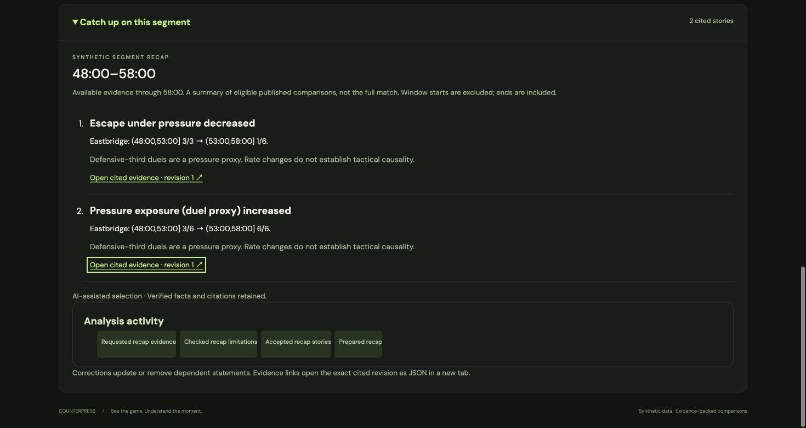

# Bounded recap adaptation with Microsoft Agent Framework

Stage 8 eighth increment adds a real Analyst/Producer graph over the frozen
multi-story segment recap. Azure OpenAI supplies editorial decisions: review the
eligible stories, optionally narrow the selection, and choose approved brief or
detailed wording. The application supplies every name, number, window, limitation
and citation. Arbitrary generated prose never reaches the recap.

## Run

Use the existing local Azure configuration. No additional resource is needed.
The command explicitly loads `.env`; it never prints the key, endpoint or
deployment name. Each invocation can make paid provider requests.

```sh
UV_CACHE_DIR=.uv-cache uv run --env-file .env --frozen python -m counterpress.workflow.recap pressure-increase
# Request an independent language/viewpoint variant when needed:
UV_CACHE_DIR=.uv-cache uv run --env-file .env --frozen python -m counterpress.workflow.recap pressure-increase --language zh-Hans --depth casual
```

Options: `--at-ms`, `--db`, `--fixtures`, `--language`, `--depth`, `--club`,
`--player`, `--metric-focus`. The database defaults to `var/counterpress.sqlite3`;
use the same file for the API to see the result. Open **Pressure and escape shift**,
go to **58:00**, and expand **Catch up on this segment**. Accepted presentation is
valid for at most sixty seconds from workflow start. Polling never triggers or
renews a model call. CLI exit 0 means accepted, narrowed or rejected; exit 2 means
skipped or fallback. Unconfigured, incomplete, hidden, empty and historical
recaps do not make provider requests.

## Frozen review and fresh handoff

A fingerprint binds the factual recap, match, score, cutoff, comparison windows,
viewing preferences, source journal version and presentation template version.
The Analyst must request both parameterless read-only tools:

| Tool | Result |
| --- | --- |
| `get_recap_evidence` | Frozen eligible identities, metric facts/rules/windows, exact event revision references and current score |
| `get_recap_limits` | Synthetic segment coverage, viewpoint, maximum story count and factual qualifications |

The Analyst may accept all eligible stories, narrow to a nonempty proper subset,
or reject. Code validates the fingerprint, reason, unique exact identities and
original preference-ranked order. A rejection skips the Producer and leaves the
factual recap available. The model cannot resurrect withdrawn stories, expand the
candidate pool, override eligibility or reorder stories against the ranking.

The Producer receives a fresh code-built package with only the reviewed identities,
preferences and approved wording alternatives. No Analyst transcript is passed.
It selects one of two heading labels and brief/detailed wording per statement.
Code checks identity, order, language and fingerprint, then inserts the chosen
approved wording. Qualifications and evidence links are retained in both styles.
A casual source already uses brief wording, so selecting detailed does not invent
additional content. Narrowing increases the disclosed omitted-story count.

## Limits, persistence and fallback

The existing guarded transport and tool middleware enforce at most three Analyst
requests, one Producer request, four total provider requests and three tool calls.
Retries and redirects are disabled. The shared eight-second monotonic deadline
starts before source preparation. Response size is limited to 64 KiB after
decoding. Checks occur before invocation, after responses, before handoff and
inside the final commit transaction. Cancellation/audit overhead may finish after
the deadline, but late presentation cannot be published.

No transaction spans a provider await. Another viewer can read replay state or
commit a correction while the workflow waits. The code compares the full source
journal and all publication streams before Producer handoff and atomically before
commit. Any intervening source or publication change conservatively invalidates
the result, even if the selected statement's numbers did not change.

The additive SQLite `recap_workflows` table retains append-only attempts:
preferences, frozen citations/fingerprint, prompt version, source version,
availability, timestamps, request/tool counts, duration, action labels, validated
presentation choices and fixed reason codes. It stores no resource identifier,
credentials, provider error body, raw transcript or free-form model prose.
Existing histories migrate without rewriting source or publication tables.

Snapshot fields:

- `recap`: the complete deterministic factual fallback, always retained.
- `adapted_recap`: only a current, successful, unexpired presentation; otherwise null.
- `recap_workflow`: compact activity/status, applied flag, heading and expiry.

The browser checks the adapted statements against the factual selection and
current ledger. A local expiry timer restores the full factual recap even before
the next poll. Corrections, cutoff changes and preference changes invalidate the
fingerprint; viewer scopes and existing revision watermarks prevent stale replay.
Expired/stale/failing attempts keep their audit while the UI shows factual wording.

## Verification

The actual Agent Framework/SDK/transport boundary is exercised with deterministic
mock responses for both languages, acceptance/narrowing/rejection, malformed
identities, added prose, missing tools, tool limits, timeout/cancellation,
concurrent corrections before handoff and before commit, expiry, restart,
append-only guards and additive migration. Frontend tests exercise citation
validation and exact expiry fallback. Existing request-budget checks also remain.

One live Azure run on 16 October 2026 returned **accepted** in **7,304 ms** with
three provider requests (two Analyst, one Producer) and two tool calls. Both
stories retained their original citations and factual fractions. This one sample
is not a measured P95 or a reliability guarantee. Bilingual behavior was checked
offline; this live run used English. Sanitized result:
[`verification/recap-workflow-live.json`](verification/recap-workflow-live.json).

Browser review confirmed the accepted presentation, then automatic fallback on
expiry with both evidence links intact and no browser warnings/errors.



## Next milestone

Proceed to Stage 9 with a containerized backend/frontend path and configuration,
then Cosmos DB durability, Event Hubs ingestion and Web PubSub delivery. The current
application remains local; an Azure model call does not establish cloud hosting or
cloud restart recovery. Stage 10 still needs measured evaluation and the final
demonstration. The requested as-built architecture and prioritized Microsoft
extensions will be delivered after those build-plan stages are complete.
