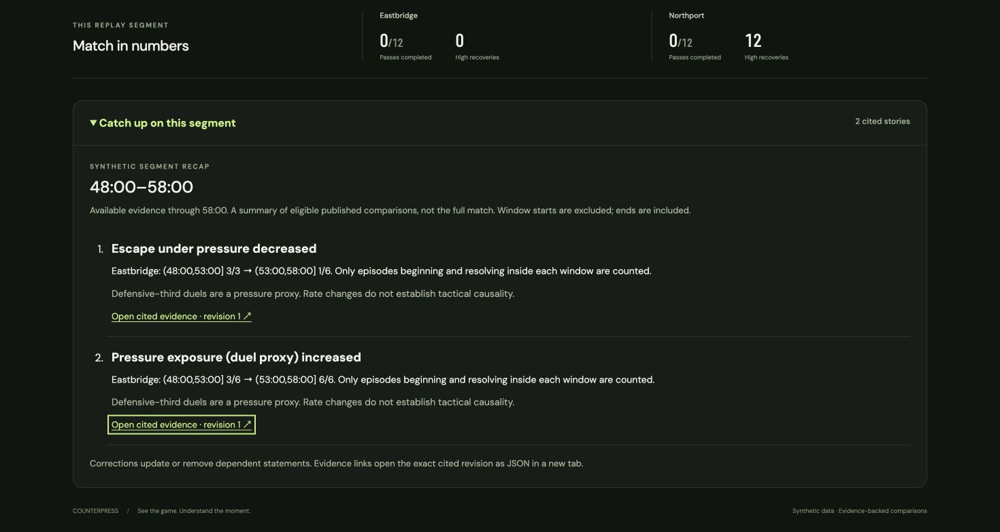

# Evidence-linked segment recaps

Stage 8 seventh increment adds a factual catch-up summary of the fixed synthetic
48:00–58:00 segment. This is not a full-match report. It does not infer scoring
events, event chronology, player ratings or tactical causes from aggregate changes.
The scoreboard remains the authoritative replay state.

In the browser, choose **Pressure and escape shift**, click **Go to comparison**,
then expand **Catch up on this segment**. The two statements retain the reviewed
fractions: pressure exposure 3/6 → 6/6, pressured escape 3/3 → 1/6. English and
Simplified Chinese use the same evidence and preserve names and numbers.



## Selection and citations

The existing snapshot API includes a `recap` object. No new external service,
model call or database table is required:

```sh
curl -s 'http://127.0.0.1:8000/api/scenarios/pressure-increase/snapshot?at_ms=780000&language=en&depth=analyst&metric_focus=pressure_exposure'
```

`SegmentRecap` contains the match ID, requested cutoff, both observation windows,
viewing preferences, state, up to four statements, and an omitted-story count.
Each statement contains a reviewed `NarrativeVariant` and a `RecapCitation` with
publication kind, stable insight ID, exact revision, evidence ID and availability.
The evidence ID/version is carried by the frozen publication; one publication
revision identifies the associated evidence revision.

Composition uses the same immutable history read as the rest of the snapshot.
For each publication identity, select the latest revision available at the
requested cutoff **before** excluding withdrawals. Never fall back to an older
eligible revision. Reuse deterministic, validated presentation templates; model
adaptations are not inputs to this increment.

Rank eligible stories using the existing club/player/metric preferences, then
publication kind (recovery, pressure, contribution) and stable insight ID for ties.
Club preference ranks rather than filters. Player preference requires recorded
involvement; player-share stories require the actual attributed recovery actor.
A preference never changes totals, thresholds or eligibility. Recap list order is
ranking, not the temporal order of football events. Maximum length is four; show
how many eligible stories were omitted. A recovery control can have eligible
progression stories: detector controls are not necessarily controls for every rule.

The recap is collapsed by default and separate from the single main alert card.
Card budget zero suppresses it entirely. Before 58:00 its state is `collecting`;
a completed comparison with no eligible stories is `no_eligible`. Empty text
explicitly avoids implying that nothing happened in the match.

Evidence links open exact frozen JSON revisions through the existing recovery,
pressure or contribution endpoints, with the recap cutoff included. Old revisions
remain auditable; the current recap references only the latest eligible revision.
No endpoint URLs or model credentials are included in recap payloads.

## Correction and playback checks

The pressure fixture begins with two stories. At 58:05, exposure updates to revision
2 (2/6 → 6/6) and escape withdraws. At 58:10 neither statement remains. At 58:15
both restore, with exposure revision 4 and escape revision 3. A request for 58:00
still returns the original two statements, including after a database restart.

Player corrections independently check 1/4 → 3/4, a source-only citation update
without changed numbers, withdrawal, restoration, and no credit for duel winners.
Recovery corrections check that withdrawing one story leaves unrelated eligible
stories visible. Every positive scenario's citations resolve to the exact stored
evidence via the API.

The client validates match, cutoff, windows, preferences, evidence identity,
publication revision, availability and non-withdrawn lifecycle status before
accepting a recap. Existing per-stream revision watermarks prevent stale snapshots
from restoring withdrawn statements. Recaps share snapshot scope: rewinds,
scenario changes and viewer/preference changes clear old content and collapse the
recap. They do not alter producer history.

## Remaining work

The factual template portion is now complemented by the [bounded recap workflow](recap-workflow.md).
It reviews frozen identities and selects approved presentation choices with an
atomic correction check and deterministic fallback. Full-match recaps still need
broader fixture coverage; this ten-minute sample cannot support that claim.

Stage 9's deployed Azure path and Stage 10's measured evaluation/demo remain
outstanding. The factual recap itself requires no model call or Azure resource.
