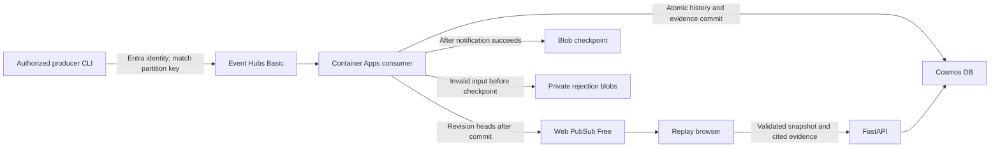

# Event Hubs ingestion and Web PubSub revisions

The streaming path is optional. Local development still runs without Azure and
uses the existing HTTP snapshots. Azure mode adds an Event Hubs consumer to the
single FastAPI process, Blob checkpoints and rejection storage, and Web PubSub
revision notices. The application continues to derive every visible fact from a
validated snapshot. Deployment and live proof are recorded in the progress log.

## Delivery and recovery



A version-1 `Delivery` contains `delivery_id`, allowlisted `scenario_id`, stable
`match_id`, and 1-32 typed `Event` records. The encoded body is limited to 240,000
bytes. The producer sets the Event Hubs partition key to `match_id`; the consumer
checks it and the scenario's registered match. This increment appends deliveries
and corrections to seeded curated matches, not arbitrary external match imports.
Event identity/revision, source sequence, availability and possession rules remain
those of the existing journal. Delivery IDs are transport labels; source event
identities provide idempotency even when the envelope gets a new delivery ID.

The consumer commits the source and derived publication history, sends current
revision heads to the scenario group, then checkpoints that Event Hubs offset.
It retries the same event on transient storage, notification or checkpoint errors;
it never returns and allows a later offset to skip a failed delivery. A crash after
commit but before notification/checkpoint causes replay and another notice without
duplicate facts. This is at-least-once processing, not exactly-once messaging.

Invalid input is durably quarantined under its partition/sequence identity before
checkpointing. Bounded raw input remains in a private Blob container with a digest
and fixed reason code; oversized bodies retain only a digest. Do not place secrets
in deliveries. Quarantine failure also blocks checkpoint advancement. Rejections
are not automatically repaired or reprocessed; inspect and submit corrected source
records deliberately. Logs contain fixed status codes, not tokens or event bodies.

A notice carries match/scenario, source-history length, replay horizon and latest
per-story revision, operation and availability. It coalesces intermediate changes
in one envelope; historical publications remain in Cosmos. No arbitrary model text,
counts, viewer preferences or raw events are pushed. Only Event Hubs ingestion
sends notices; local CLI writes are discovered by snapshot reconciliation.

## Browser connection and fallback

`GET /api/revisions/negotiate?scenario_id=...` returns disabled in local mode, or
an expiring Web PubSub connection URL in cloud mode. This public synthetic demo
issues receive-only tokens prejoined to one allowlisted scenario group. It grants
no group-send or group-join roles. Token issuance is capped at 30 attempts/minute
per process; responses are no-store and failures are sanitized. The service URL
and temporary bearer token are necessarily visible to the connecting browser;
model keys/endpoints and service credentials are never sent to it. A private-data
product would require authenticated viewers and match-level authorization here.

The client opens a plain WebSocket, validates notice shape and scenario, and
suppresses duplicate/older history versions. A notice triggers an HTTP snapshot
at the viewer's current position; it never advances a paused playhead or inserts
pushed facts. Existing scope, cutoff, preference and lifecycle checks still apply.

Every connection/reconnection fetches a fresh snapshot. Reconnect delays grow to
30 seconds; closing or changing scenarios cancels the old connection. Connected
clients also reconcile every 30 seconds; disconnected/disabled clients poll every
two seconds. Playback ticks continue to fetch time-specific snapshots. This repairs
missed notifications and quota interruptions without claiming durable WebSocket
replay. The UI indicates live connection or periodic update checking.

## Azure resources and identity

`infra/streaming.bicep` creates, within the existing group:

- Event Hubs Basic, one throughput unit, one partition, one-day retention and the
  built-in `$Default` consumer group. Auto-inflate and key authentication are off.
- Web PubSub Free, one unit; key authentication off. Free limits are 20 concurrent
  connections and 20,000 outbound messages/day, with no SLA.
- Standard LRS Blob storage with private checkpoint and rejection containers.
  Shared-key access and public blob access are disabled.
- A stream managed identity with Event Hubs receiver access on the hub, Blob Data
  Contributor on those two containers, and Web PubSub Service Owner on that service.
- A separate feed managed identity with sender access only on the event hub.

`infra/app.bicep` enables these only with `useStreaming=true`; Cosmos must also be
enabled. Both identities attach to the existing app. The feed identity is used only
by explicit producer/check commands; there is no public ingestion route. Existing
Cosmos and registry identities keep their current scopes.

The app remains at zero-to-one replicas. An identity-authenticated `azure-eventhub`
scale rule checks unprocessed events using the Python SDK's `blobMetadata`
checkpoint strategy. HTTP traffic can also activate the app. A new delivery can
wake an idle consumer; cold starts and scaler polling mean this is not a guaranteed
subsecond delivery system. Event Hubs retention is finite: recover an outage before
its one-day retention expires. No regional disaster-recovery claim is made.

## Cost and provisioning

The checked East US retail Basic price on 16 October 2026 is USD 0.015 per
throughput-unit hour, plus USD 0.028 per million ingress billing units. At one TU,
28 continuous days cost about USD 10.08 before ingress, storage and network usage.
Web PubSub Free adds no service-tier charge; no paid upgrade is automatic. Blob
operations/storage and app processing remain usage-based. This fits the existing
USD 20 streaming allowance inside the USD 75 total trial envelope, subject to the
other services' usage. Budget alerts do not stop spending. Close unused demo tabs.

Register `Microsoft.EventHub` and `Microsoft.SignalRService` if necessary. Compile
and review incremental `what-if` for `infra/streaming.bicep`, then deploy it. Build,
smoke-test and secret-scan the image, push it to the private registry and deploy
`infra/app.bicep` with the exact image digest, `useCosmos=true`, `useStreaming=true`.
Give new data roles time to propagate. Do not disable authentication or broaden
network/security settings to work around a propagation delay.

The deployed runtime receives private environment settings for the Event Hubs
namespace/name, Blob endpoint, PubSub endpoint and stream/feed identity client IDs.
See `streaming/azure.py` for the exact `COUNTERPRESS_*` names. No connection string
or service key is required. Roll back app streaming with `useStreaming=false` while
retaining `useCosmos=true` and the last verified image; this restores polling but
does not delete history, checkpoints or stop Event Hubs' hourly charge. Remove the
streaming resources explicitly when the hackathon ends if they are no longer needed.

## Use and verify

Choose **Live recovery corrections**, then **Go to comparison**. An authorized
producer can send the authored updates with this explicit command from the
configured app container (or local Azure CLI identity with a hub sender role):

```sh
python -m counterpress.streaming.send stream-recovery /app/fixtures/faults/recovery_corrections.json
```

The dedicated scenario has its own match identity and partition. It starts from
the original recovery fixture. After processing, **View latest corrections** reveals
58:05 (1 to 3), 58:10 (withdrawn recovery) and 58:15 (1 to 2). Other eligible stories
may be selected after withdrawal. Seeking back to 58:00 retains 1 to 4. Sending the
same source revisions again is harmless; it does not create a new demo cycle.

```sh
UV_CACHE_DIR=.uv-cache uv run --frozen pytest -q
npm --prefix frontend test
npm --prefix frontend run build
bash scripts/test_container.sh counterpress:streaming
# Inside the configured Azure revision; sends two duplicate synthetic deliveries:
python -m counterpress.streaming.check --exercise
# After restarting the revision; reads only:
python -m counterpress.streaming.check
```

Tests cover routing, malformed/conflicting deliveries, durable rejection ordering,
post-commit retry, checkpoint ordering, duplicate facts, revision heads including
withdrawal, receive-only tokens, negotiation limits, reconnect resynchronization,
duplicate/stale notices and scenario cleanup. Live checks separately require actual
Event Hubs, Blob, Cosmos and Web PubSub; offline doubles are not deployment proof.

References: [Event Hubs Python SDK](https://learn.microsoft.com/en-us/azure/event-hubs/event-hubs-python-get-started-send),
[KEDA checkpoint strategy](https://keda.sh/docs/2.18/scalers/azure-event-hub/),
[Container Apps identity scaling](https://learn.microsoft.com/en-us/azure/container-apps/scale-app),
[Web PubSub managed identity](https://learn.microsoft.com/en-us/azure/azure-web-pubsub/howto-authorize-from-managed-identity),
[Web PubSub limits](https://azure.microsoft.com/en-us/pricing/details/web-pubsub/).
